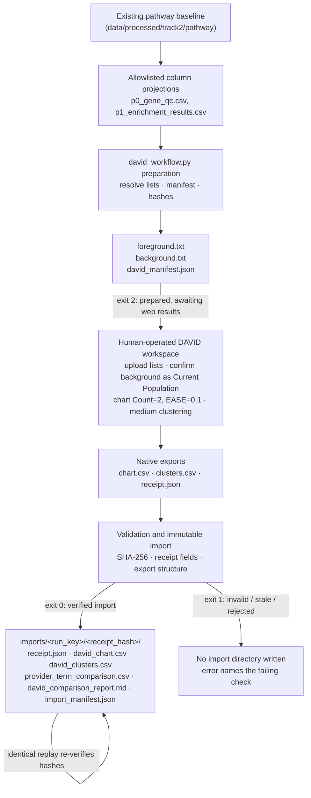

# Final Report: DAVID Functional Annotation and Pathway Enrichment Addendum for Mosaic Variegated Aneuploidy

## 1. Executive Summary

### The DAVID-Only Scientific Question

This addendum addresses one narrow question for the **Rare Disease, Real Kid: MVA Hackathon 2026**:

> *Do the Phase 1 candidate genes, tested against their evaluated-gene universe with the native DAVID web interface, supply supplementary over-representation and clustering evidence that is consistent with, or adds exploratory context to, the existing g:Profiler enrichment branch?*

DAVID (Database for Annotation, Visualization and Integrated Discovery) was used as a **secondary interpretation branch**. No DAVID API call was made and no account or session was created by this repository's code: a human operator ran the analysis on the native DAVID web workspace, and the repository's software prepared the inputs beforehand and verified and imported the resulting exports afterward.

### Headline Analytical Trajectory

1. **Preparation (`exit 2`)**: The workflow read allowlisted column projections of `p0_gene_qc.csv` and `p1_enrichment_results.csv` from the existing pathway baseline and wrote three artifacts outside the repository: `foreground.txt` (1,926 Ensembl gene identifiers), `background.txt` (8,740 identifiers), and `david_manifest.json` binding namespace, taxonomy, settings, and content hashes.
2. **Native-web execution (human-operated)**: Both lists were uploaded to the DAVID workspace, the uploaded background was confirmed as the current population, and one Functional Annotation Chart (`Count=2`, `EASE=0.1`) and one medium-stringency Functional Annotation Clustering report were run and saved.
3. **Import and comparison (`exit 0`)**: The native exports (`chart.csv`, `clusters.csv`, `receipt.json`) were validated against the manifest by SHA-256 and structural checks, imported immutably, and compared with the g:Profiler branch strictly on stable term identifiers. A byte-identical replay re-verified hashes and wrote nothing.

### Measured Outcomes (live run)

- Foreground mapping: **1,926 submitted**, **1,591 mapped** by DAVID.
- Background mapping: **8,740 submitted**, **8,371 mapped**.
- Functional Annotation Chart: **318 term rows**, of which **2** met `Benjamini ≤ 0.05`.
- Functional Annotation Clustering (medium stringency): **1,812 annotation rows**.
- Stable-identifier comparison: **74 shared**, **134 DAVID-only**, **16,380 g:Profiler-only** term identifiers, plus **111 DAVID rows** without a supported stable identifier.
- Gene-level contributor overlap (Jaccard) was **not calculated**: the saved g:Profiler projection lacks contributing-gene membership.
- The DAVID import left the P0–P7 baseline unchanged and replayed with byte-identical output.

The checked-in documentation does **not** name the two significant terms and does **not** report the number of distinct DAVID clusters; this report therefore does not name or count them either. Section 5 states exactly which values are unavailable.

### What This Addendum Concludes

DAVID supplied supplementary over-representation and clustering evidence over the same Phase 1 selection. Because only two chart terms met the Benjamini decision rule and shared identifiers measure annotation overlap rather than independent replication, DAVID's contribution here is **context for interpretation**, not confirmation of specific pathways, not pathway activation, and not a clinical or pharmacological result.

> **Research-Only Mandate.** This report is a computational research document for the MVA hackathon. Every statement herein concerns gene-annotation enrichment hypotheses only and is strictly non-diagnostic. Nothing in this report is a diagnosis, a medical recommendation, a treatment proposal, or an assessment of clinical suitability for any individual. No findings should be construed as supporting any drug, dose, or clinical decision.

## 2. Scope, Ethics, and Data Governance

### What Crossed the External-Service Boundary

DAVID is an external service. Only two kinds of content were sent to it:

1. **Normalized Ensembl gene identifiers** — the foreground and background gene lists, as plain text files with one identifier per line. No gene symbols beyond what the mapping resolution requires, and no variant-level content.
2. **A selected gene universe** — the background list of genes eligible to have been selected by the upstream analysis.

Never transmitted: VCF or any variant record, genotypes, genomic coordinates, alleles, HGVS strings, phenotype narratives, sample identifiers, patient identifiers, or clinical text.

### Where the Artifacts Live

Every prepared list, native download, receipt, and imported DAVID artifact was kept **outside the repository** in operator-chosen local directories. The repository refuses to write DAVID destinations inside ignored trees such as `data/processed/**` instead of writing them (`_validate_output_path`). Consequently, the native DAVID results are intentionally **not version-controlled**; the durable, checked-in record of the run is the aggregate documentation cited in this report (`docs/JOURNEY.md`) plus the software contract (`src/mva_hackathon/david_workflow.py`, `scripts/README.md`).

### Repository Read Boundary

The baseline was read only through **allowlisted column projections**: `p0_gene_qc.csv` contributed `SYMBOL`, `ENSEMBL_ID`, `STATUS`, `IN_FOREGROUND`; `p1_enrichment_results.csv` contributed term-level columns (`SOURCE`, `TERM_ID`, `TERM_NAME`, `BH_Q`, `PROVIDER_ADJUSTED_P`, `PROVIDER_CORRECTION`, `RAW_P`, `FOLD_ENRICHMENT`, `CONTRIBUTING_GENES`, `BACKGROUND_LABEL`). No other columns were read, no P2–P7 artifact was rewritten, and the projection contents are fingerprinted by SHA-256 in the manifest so any later baseline change invalidates the DAVID import instead of silently reusing it.

## 3. DAVID Workflow and Data Flow

The workflow is a resumable, human-in-the-loop protocol with three exit states:



**Exit semantics.** `2` means preparation completed and the run is awaiting native web results. `0` means a receipt-validated import completed, or an identical replay re-verified the recorded hashes. `1` means invalid input, stale or non-matching provenance (`STALE_OR_INVALID_PROVENANCE`), a rejected receipt, or mismatched export hashes; no partially trusted import directory survives a failure, because the import step removes its own directory before re-raising.

**Determinism.** The manifest is keyed by a `run_key` derived from the baseline projection hashes, the combined list hash, namespace (`ENSEMBL_GENE_ID`), taxon (`9606`), and the recorded settings. Any change to the baseline projections, the lists, or the settings produces a new key and invalidates prior imports rather than silently extending them.

## 4. Methods and Statistical Semantics

### Configuration

| Parameter | Value | Source of constraint |
|---|---|---|
| Organism / taxon | Homo sapiens (`9606`) | Manifest-verified; receipt must match |
| Identifier namespace | `ENSEMBL_GENE_ID` | Manifest-verified; receipt must match |
| Foreground size cap | 3,000 identifiers | `_FOREGROUND_LIMIT`; DAVID documents clustering/classification limits at 3,000 genes |
| Background | Custom uploaded list (8,740 identifiers), confirmed by the operator as the Current Population | `population_confirmed` must be `true` in the receipt |
| Chart settings | `Count=2`, `EASE=0.1` | Manifest-recorded; receipt interface settings must match exactly |
| Clustering | Displayed stringency "Medium"; actual categories and thresholds recorded in the receipt | Receipt requires a nonempty `actual_categories_and_thresholds` record |
| Significance rule | `Benjamini ≤ 0.05` | Pre-specified counting rule for this addendum |

### Statistical Quantities, Kept Separate

- **EASE score** — DAVID's conservative modified one-sided Fisher exact p-value: enrichment is recalculated after subtracting one foreground hit from the annotated-term count, so terms supported by only one foreground gene receive EASE p = 1. A low EASE score is evidence of over-representation, not a causal probability or a pathway-activity score.
- **`P-Value`** — the native unadjusted over-representation p-value.
- **`Benjamini`** — the Benjamini–Hochberg adjusted p-value across the tested terms. This addendum counts significance with `Benjamini ≤ 0.05`.
- **`FDR`** (native DAVID column) — an adaptive-method estimate that is **not** Benjamini–Hochberg and is never pooled with or substituted for it.
- **`Cluster Enrichment Score`** — approximately $-\log_{10}$ of the geometric mean of the member terms' EASE p-values. It ranks clusters; it is **not** an adjusted p-value, not a false-discovery rate, and not a drug-target score.
- **Display thresholds vs. significance rule.** `Count=2` and `EASE=0.1` are the chart's display filters. The number of significant terms in this report is counted by `Benjamini ≤ 0.05` over the returned chart rows; a term failing the display thresholds would not appear in the chart at all, which is itself a coverage constraint on what could be counted.

### Comparison Semantics

The provider comparison matches g:Profiler and DAVID terms **only on stable identifiers** (GO, Reactome `R-HSA`, KEGG `hsa`, WikiPathways `WP`, HP), canonicalized in one pass (for example, KEGG sources are normalized to `hsa`-prefixed identifiers). Term titles and free text **never** produce a match. Provider statistics (p-values, adjusted values, scores) are recorded per provider inside the comparison rows and are never pooled, averaged, or jointly re-ranked. Rows without a supported stable identifier on either side are labeled `unmapped_term` with a `null` identifier rather than being dropped or force-matched by name. Gene-level Jaccard is computed only when **both** providers expose complete, resolvable contributor sets for a shared term; unavailable contributors produce a null Jaccard and an explicit note, never a zero.

## 5. Execution Results

All quantitative rows below are measured live-run aggregates recorded in `docs/JOURNEY.md` ("Pathway results: g:Profiler and DAVID"). No synthetic or illustrative value appears as a run result in this report.

### 5.1 Identifier Mapping

| List | Submitted identifiers | Mapped by DAVID | Mapping loss |
|---|---:|---:|---|
| Foreground (Phase 1 selection) | 1,926 | 1,591 | 335 identifiers (17.4%) |
| Custom background | 8,740 | 8,371 | 369 identifiers (4.2%) |

Mapping loss is reported as submitted minus mapped. Enrichment statistics operate on DAVID's internally resolved unique gene entities after mapping, so the effective tested foreground is the mapped subset, not the submitted count.

### 5.2 Functional Annotation Chart

| Metric | Value |
|---|---:|
| Chart term rows returned (after `Count=2`, `EASE=0.1` display thresholds) | 318 |
| Terms meeting the pre-specified rule `Benjamini ≤ 0.05` | 2 |
| Names of the two significant terms | **Not recorded in the checked-in documentation — unavailable** |

The available repository documentation does not name the two significant terms. This report deliberately does not infer them. A term-level table is therefore not reproduced here, and no top-pathways table is presented, because reproducing it would require either the external (non-versioned) `david_chart.csv` or a checked-in record that does not exist.

### 5.3 Functional Annotation Clustering (Medium Stringency)

| Metric | Value |
|---|---:|
| Annotation rows in the medium-stringency clustering report | 1,812 |
| Number of distinct clusters | **Not recorded in the checked-in documentation — unavailable** |

The number of distinct clusters is computable from the external, non-versioned `clusters.csv` (the import report counts distinct `Cluster` values) but was not recorded in the checked-in aggregate documentation; it is therefore unavailable here and is not estimated.

### 5.4 Provider Comparison (Stable Identifiers Only)

| Comparison category | Count | Meaning |
|---|---:|---|
| Shared stable term identifiers | 74 | Both providers returned the term; overlap of annotation coverage |
| DAVID-only stable identifiers | 134 | DAVID-returned terms absent from the saved g:Profiler projection |
| g:Profiler-only stable identifiers | 16,380 | Terms in the saved g:Profiler comparison set that DAVID's chart did not return |
| DAVID rows without a supported stable identifier | 111 | Chart rows whose term could not be canonicalized; labeled `unmapped_term`, never matched by title |

For scale: the saved g:Profiler comparison set contains 16,455 terms in total, including all returned terms, not only significant ones. The background is not a whole-exome callable universe. Gene-level contributor overlap (Jaccard) was not calculated because the saved g:Profiler projection lacks contributing-gene membership; the comparison machinery computes it only when complete contributor sets exist on both sides, and reports null with an explicit note otherwise.

### 5.5 Unavailable Values (Explicit Register)

| Quantity | Status |
|---|---|
| Names of the 2 terms with `Benjamini ≤ 0.05` | Unavailable in checked-in documentation; not inferred |
| Number of distinct DAVID clusters | Unavailable in checked-in documentation; not inferred |
| Contributor-gene Jaccard for shared terms | Not calculated; saved g:Profiler projection lacks contributor membership |

## 6. Interpretation

### Mapping Loss Shapes the Effective Test

Roughly one in six foreground identifiers did not map (1,926 → 1,591). Any gene absent after mapping cannot contribute to any term, so the enrichment test is run on the mapped subset. DAVID applies the same resolution to the background (8,740 → 8,371), which limits but does not eliminate the distortion: the ratio of retained foreground to retained background genes differs by term coverage, and a term enriched only among unmapped genes is invisible. This is a structural property of external ID resolution, not an error state; the manifest and receipt preserve the counts so the loss is auditable.

### Shared Identifiers Are Annotation Overlap, Not Replication

The 74 shared stable identifiers say that DAVID and g:Profiler both returned those terms under their respective tests. The two providers differ in annotation coverage, universe handling, correction method (g:Profiler's default is g:SCS, not BH), and knowledgebase versions, so agreement is **interpretive consistency**. It is not independent statistical replication of a significant pathway, and the providers' adjusted values were never pooled here.

### DAVID-Only Terms Are Exploratory

The 134 DAVID-only identifiers reflect DAVID's broader annotation surface (additional term sources, different mapping, different chart filters). Under this addendum's rules, DAVID-only terms — particularly any with `Benjamini > 0.05` — are exploratory annotation themes, not confirmed pathways, and are not promoted into the g:Profiler branch's conclusions.

### What DAVID Does and Does Not Establish

- DAVID provides **biological annotation context**: which curated terms are over-represented among the Phase 1 genes relative to the uploaded background.
- It does **not** provide: gene causality, pathway activity or direction of activation, demonstrated protein dysfunction, patient-specific pathway state, target validation, drug efficacy, or clinical actionability.
- A pathway term derived from a candidate gene matrix is a **hypothesis** about which annotation themes the selection touches, not a measurement of pathway behavior in any individual.
- The medium-stringency clustering groups redundant terms by shared gene membership (Kappa similarity, fuzzy heuristic clustering); a cluster is a bookkeeping structure over annotations, not a physical protein–protein interaction network.

Consistent with the addendum's scope, g:Profiler appears in this report only as the provider of the stable-identifier comparison emitted by the DAVID import. Broader g:Profiler results, P2–P7 prioritization, drug evidence, STRING or Reactome adjudication, and any pharmacological conclusion are outside this report's evidence and are not summarized as DAVID findings.

## 7. Methodological Limitations

1. **Foreground/background selection bias.** The foreground is a Phase 1 candidate selection, not an unbiased sample; the background is the uploaded evaluated-gene universe, not a whole-exome callable universe. Any bias in how genes entered Phase 1 (rarity gating, impact gating, inheritance rules) propagates into the enrichment test.
2. **Gene-length and annotation-density bias.** WGS-derived over-representation analysis is conventionally biased by gene length, coverage, and annotation density: longer and more-annotated genes are likelier to hit term thresholds. DAVID's chart does not correct for this; observed enrichment partly reflects detectability.
3. **DAVID mapping loss.** 335 foreground and 369 background identifiers did not resolve, shrinking and reshaping the tested set; terms supported mainly by unmapped genes cannot be observed.
4. **Point-in-time knowledgebase and session state.** DAVID's annotation sources and the exact session state (categories available, thresholds as applied) exist only in the external, non-versioned receipt and exports for this run date. Results are not reproducible against a different knowledgebase date without re-running the native session.
5. **EASE / Benjamini–Hochberg / native FDR semantics.** EASE is a conservative modified Fisher statistic; `Benjamini` is BH-adjusted; the native `FDR` column is an adaptive estimate distinct from BH. Conflating any of these — or treating the `Count`/`EASE` display filters as the significance rule — would change the count of significant terms.
6. **Clustering is not a physical network.** Functional Annotation Clustering is Kappa-similarity grouping of terms by shared genes; the cluster enrichment score is a rank of member EASE p-values. Neither establishes interactions, regulation, or pathway causality.
7. **Missing contributor overlap.** Because the saved g:Profiler projection lacks contributing-gene membership, the addendum cannot show which genes drive the 74 shared terms; overlap may be driven by entirely different genes on each side.
8. **Unnamed significant terms in checked-in documentation.** The two `Benjamini ≤ 0.05` terms are not identified anywhere in the version-controlled record. Readers cannot audit their plausibility from this repository alone; this is a documented evidence gap, not a resolved result.
9. **No wet-lab or functional validation.** No experiment, model system, or clinical dataset validates any annotation theme reported here. All conclusions are computational and hypothesis-generating only.

## 8. Reproducibility and Artifact Catalog

### Operator Commands

From `scripts/README.md` ("DAVID addendum"), run from the repository root with `uv`:

```bash
# 1. Prepare lists from an existing pathway baseline (P0–P7 are not rerun).
uv run python scripts/run_pathway_workflow.py --david \
  --reuse-pathway-dir data/processed/track2/pathway \
  --output-dir /path/outside/the/repo/david
# -> exit 2: writes foreground.txt, background.txt, david_manifest.json

# 2. At https://davidbioinformatics.nih.gov/workspace.html upload both lists,
#    confirm the uploaded background as Current Population, run one chart
#    (Count=2, EASE=0.1) and one clustering report, then save chart.csv,
#    clusters.csv, and receipt.json into a single export directory.

# 3. Import and compare. Identical replay verifies hashes and writes nothing.
uv run python scripts/run_pathway_workflow.py --david \
  --reuse-pathway-dir data/processed/track2/pathway \
  --output-dir /path/outside/the/repo/david \
  --david-exports /path/outside/the/repo/exports

# 4. Attach the addendum to a fresh full run instead of running DAVID alone.
uv run python scripts/run_pathway_workflow.py --gene-mechanism <phase1 genes> \
  --with-david --david-output-dir /path/outside/the/repo/david \
  --output-dir /path/outside/the/repo/pathway
```

CLI constraints: `--reuse-pathway-dir` requires `--david` or `--stage david`; `--with-david` requires the default `--stage all`, rejects `--david`, and requires `--david-output-dir`.

### Artifact Catalog

| Artifact | Stage | Location | Versioned in Git |
|---|---|---|---|
| `foreground.txt` | Preparation | external `--output-dir` | No — external artifact |
| `background.txt` | Preparation | external `--output-dir` | No — external artifact |
| `david_manifest.json` | Preparation | external `--output-dir` | No — external artifact |
| `chart.csv` | Native export (human-saved) | external exports directory | No — external artifact |
| `clusters.csv` | Native export (human-saved) | external exports directory | No — external artifact |
| `receipt.json` | Native export (human-saved) | external exports directory | No — external artifact |
| `receipt.json` (copy) | Import | `imports/<run_key>/<receipt_hash>/` under `--output-dir` | No — external artifact |
| `david_chart.csv` | Import | same immutable version directory | No — external artifact |
| `david_clusters.csv` | Import | same immutable version directory | No — external artifact |
| `provider_term_comparison.csv` | Import | same immutable version directory | No — external artifact |
| `david_comparison_report.md` | Import | same immutable version directory | No — external artifact |
| `import_manifest.json` | Import | same immutable version directory | No — external artifact |

The checked-in durable record of the live run is the aggregate documentation in `docs/JOURNEY.md`, which is what this report cites; the biological data artifacts themselves are intentionally external.

### Validation Guarantees and Their Limits

- **SHA-256 validation.** The receipt's `export_sha256` must match the actual `chart.csv` and `clusters.csv` bytes; the import records SHA-256 for every result artifact, and the manifest stores the receipt hash as `import_version`.
- **Immutable import versioning.** Results are written once into `imports/<run_key>/<receipt_hash>/`; if the directory already exists, re-import either confirms the recorded hashes (byte-identical replay, writes nothing) or fails with "immutable DAVID import version is incomplete or corrupt". A failed import removes its own directory, leaving no partially trusted state.
- **Stale-provenance rejection.** A manifest whose `run_key`, list hash, namespace, taxon, or baseline projection hashes no longer match the current baseline raises `STALE_OR_INVALID_PROVENANCE` unless explicitly forced; completed imports are re-verified by hash before reuse.
- **What the guarantees do not cover.** Hash validation proves artifact integrity and replay determinism. It does **not** prove that the native DAVID session was configured as intended beyond what the receipt records, nor does it validate the live biological counts themselves; those rest on the operator's native-session record and the checked-in aggregates.

## 9. Verified References and Resources

Primary sources for DAVID's methods and this addendum's statistical semantics:

1. DAVID official website and 2026 tool documentation — [davidbioinformatics.nih.gov](https://davidbioinformatics.nih.gov/) · [documentation](https://davidbioinformatics.nih.gov/documentation/).
2. Sherman et al., DAVID 2026 update, *Nucleic Acids Research* — [doi:10.1093/nar/gkag470](https://doi.org/10.1093/nar/gkag470).
3. Sherman et al., DAVID 2022 knowledgebase update, *Nucleic Acids Research* — [doi:10.1093/nar/gkac194](https://doi.org/10.1093/nar/gkac194).
4. Huang, Sherman & Lempicki, canonical DAVID analysis protocol, *Nature Protocols* — [doi:10.1038/nprot.2008.211](https://doi.org/10.1038/nprot.2008.211).
5. Jiao et al., DAVID Web Service, *Bioinformatics* — [doi:10.1093/bioinformatics/bts251](https://doi.org/10.1093/bioinformatics/bts251).
6. Benjamini & Hochberg (1995), controlling the false discovery rate — [doi:10.1111/j.2517-6161.1995.tb02031.x](https://doi.org/10.1111/j.2517-6161.1995.tb02031.x).

DAVID statistics and clustering technical pages referenced for method interpretation: [gene-enrichment](https://davidbioinformatics.nih.gov/documentation/tools/tech-gene-enrichment.html) · [clustering](https://davidbioinformatics.nih.gov/documentation/tools/tech-clustering.html) · [functional-annotation help](https://davidbioinformatics.nih.gov/helps/functional_annotation.html).

This report intentionally does not cite MVA genetics, drug-repurposing, STRING, Reactome, or clinical references: those belong to the broader Track 2 documentation, not to this DAVID-only addendum.
