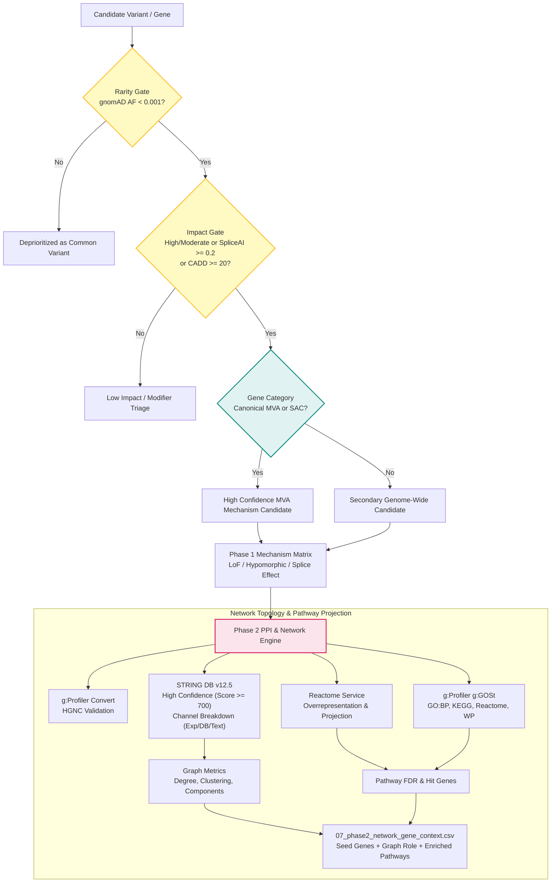

# End-to-End Analytical Journey: From Raw WGS to Pathway Network Context

## Project Mission and Non-Diagnostic Scope

The **Rare Disease, Real Kid: MVA Hackathon 2026** is focused on investigating a real child's whole-genome sequencing (WGS) data presenting with symptoms consistent with **Mosaic Variegated Aneuploidy (MVA)** and related chromosome instability conditions.

> **CRITICAL ETHICAL & RESEARCH NOTICE**
> All analyses, workflows, models, and scripts in this repository are developed strictly for **computational research and candidate exploration**. They do **not** constitute medical advice, diagnostic certainty, or clinical treatment recommendations. All patient and raw genomic data are maintained in private, uncommitted paths per strict repository governance. Computational predictions (e.g., CADD, REVEL, AlphaMissense, SpliceAI, STRING PPI, Reactome) are hypotheses and must be evaluated by clinical geneticists and molecular pathologists.

---

## 1. Complete Analytical Journey Overview

The discovery pipeline follows a layered architecture moving from raw genomic data reduction to biological pathway context without unnecessary reprocessing of heavy upstream stages.

```mermaid
flowchart TD
    classDef rawNode fill:#f9f9f9,stroke:#666,stroke-width:1px;
    classDef prelimNode fill:#e1f5fe,stroke:#0288d1,stroke-width:2px;
    classDef phase0Node fill:#e8f5e9,stroke:#2e7d32,stroke-width:2px;
    classDef phase1Node fill:#fff3e0,stroke:#e65100,stroke-width:2px;
    classDef phase2Node fill:#fce4ec,stroke:#c2185b,stroke-width:2px;

    RawWGS["Raw WGS VCF & Reads (GRCh38)"]:::rawNode

    subgraph Preliminary_Work ["Preliminary Work for Track 2 (Steps 1–3)"]
        S1["Step 1: Primary Quality Control & Normalization<br/>(bcftools norm/view, split multiallelics, DP>=10, GQ>=20)"]:::prelimNode
        S2["Step 2: Functional Consequence Annotation<br/>(Ensembl VEP v116 canonical transcripts + snpEff verification)"]:::prelimNode
        S3["Step 3: Multimodal Variant Evidence Enrichment<br/>(gnomAD v4.1, ClinVar, CADD v1.7, REVEL, AlphaMissense, SpliceAI, AlphaGenome, Exomiser)"]:::prelimNode
        MasterTbl["variant_evidence_master.csv<br/>(Consolidated multi-evidence candidate table)"]:::prelimNode
    end

    subgraph Phase0_Section ["Track 2 — Phase 0: Candidate Intake, Gating & Consolidation"]
        P0_Gate["Transparent Filter Gates<br/>AF <= 0.001, CADD >= 20, SpliceAI >= 0.2, REVEL/AM >= 0.5<br/>Canonical MVA Gene Categorization"]:::phase0Node
        P0_Out["00_phase0_consolidated_candidates.csv<br/>00_phase0_provenance.json"]:::phase0Node
    end

    subgraph Phase1_Section ["Track 2 — Phase 1: Biological Mechanism & Directionality"]
        P1_Engine["Mechanism Classifier & Archetype Fit<br/>LoF Null, Hypomorphic Missense, Splice Disruptor<br/>Direction of Effect & Biallelic Phase Gating"]:::phase1Node
        P1_Out["01_phase1_variant_mechanism_matrix.csv<br/>02_phase1_gene_mechanism_matrix.csv<br/>02_phase1_provenance.json"]:::phase1Node
    end

    subgraph Phase2_Section ["Track 2 — Phase 2: PPI & Pathway Network Context Engine"]
        P2_Engine["Runtime External API Integration<br/>g:Profiler g:Convert (HGNC Symbol Normalization)<br/>STRING DB v12.5 (Score >= 700 High-Confidence PPI)<br/>Reactome Analysis Service & g:Profiler g:GOSt"]:::phase2Node
        P2_Out["03_phase2_seed_genes.csv<br/>04_phase2_string_edges.csv<br/>05_phase2_network_summary.csv<br/>06_phase2_pathway_enrichment.csv<br/>07_phase2_network_gene_context.csv<br/>08_phase2_network_provenance.json"]:::phase2Node
    end

    RawWGS --> S1 --> S2 --> S3 --> MasterTbl
    MasterTbl --> P0_Gate --> P0_Out
    P0_Out --> P1_Engine --> P1_Out
    P1_Out --> P2_Engine --> P2_Out
```

---

## 2. Preliminary Work for Track 2 (Steps 1–3)

Before entering Track 2, the raw patient sequencing data underwent foundational quality control, transcript-level consequence annotation, and multi-tool predictive enrichment.

### Step 1: Quality Control & Normalization
- **Purpose**: Remove low-quality sequencing artifacts, decompose complex and multiallelic variants into normalized biallelic records, verify read depth and genotype quality, and retain confident variant calls against GRCh38.
- **Inputs**: Raw WGS VCF (`input/patient/WGS_EX2312012_HGWCNDSX7.vcf.gz`), GRCh38 reference FASTA (`Homo_sapiens.GRCh38.dna.primary_assembly.fa`).
- **Exact Thresholds & Values**:
  - Minimum read depth: `DP >= 10`.
  - Minimum genotype quality: `GQ >= 20`.
  - Filter: `FILTER == "PASS"`.
  - Normalization: `bcftools norm -m -any` (split multiallelic sites) and left-align indels.
- **Outputs**: High-confidence filtered variant VCF (`data/interim/filtered/pass_quality.vcf.gz` and `.tbi`), raw statistics summary (`data/interim/qc/raw_vcf_stats.txt`).
- **Conclusion & Limits**: Allelic normalization produces clean unique coordinate keys (`CHROM:POS:REF:ALT`). However, standard germline filters deprioritize low-frequency somatic mosaic variants (VAF < 15%) without dedicated mosaic callers.

### Step 2: Primary & Secondary Annotation
- **Purpose**: Annotate genomic consequences against Ensembl 116 transcript models (`VEP`) and provide orthogonal verification via `snpEff`.
- **Inputs**: `data/interim/filtered/pass_quality.vcf.gz`, Ensembl VEP 116 cache, snpEff GRCh38 database.
- **Exact Thresholds & Values**:
  - Ensembl VEP flags: `--canonical`, `--hgvs`, `--symbol`, `--biotype protein_coding`, `--numbers`, `--sift b`, `--polyphen b`.
  - Consequence filtering: High and moderate impact variants (frameshift, stop-gained, essential splice donor/acceptor, inframe indel, missense).
- **Outputs**: VEP consequence tables (`data/interim/vep/`), snpEff consequence summaries (`data/interim/snpeff/`).
- **Conclusion & Limits**: Canonical transcripts provide reproducible gene-level consequences, but may miss tissue-specific transcripts critical to neurodevelopment or embryogenesis.

### Step 3: Multimodal Variant Evidence Enrichment
- **Purpose**: Enrich candidate variants across orthogonal axes of biological deleteriousness:
  - Population allele frequency: `gnomAD v4.1` joint AF, AC, AN, NHOMALT.
  - Clinical precedence: `ClinVar` P/LP/VUS/conflicting annotations.
  - Pathogenicity ensembles: `CADD v1.7 PHRED`, `REVEL v1.3`, `AlphaMissense`.
  - Splicing disruption: `SpliceAI` delta scores (`DS_AG`, `DS_AL`, `DS_DG`, `DS_DL`) and position offsets (`DP_*`).
  - Regulatory effects: `AlphaGenome` AVI scores.
  - Phenotypic alignment: `Exomiser` run with patient HPO terms.
- **Outputs**: Unified multi-evidence table (`data/processed/variant_evidence_master.csv`).
- **Conclusion & Limits**: Multi-tool concordance enriches true functional candidates. However, in-silico predictors correlate with common training databases and do not represent wet-lab proof. SpliceAI offsets are signed nucleotide distance offsets, not read coverage.

---

## 3. Track 2 — Phase 0: Candidate Intake, Gating & Consolidation

### Task & Purpose
Phase 0 ingests the upstream evidence table (`variant_evidence_master.csv`) and optional Exomiser TSVs without rerunning upstream tools. It evaluates each candidate variant against transparent research triage gates, calculates a composite prioritization score, tags multi-hit gene candidates, and classifies genes into canonical MVA/SAC categories.

### Inputs
- Upstream evidence master table: `data/processed/variant_evidence_master.csv`.
- Optional Exomiser variant table: `data/interim/exomiser/mva_patient_exomiser.variants.tsv`.
- Optional Exomiser gene table: `data/interim/exomiser/mva_patient_exomiser.genes.tsv`.

### Exact Thresholds & Logic
1. **Rarity Gate (`GATE_RARITY`)**:
   - `gnomAD_AF <= 0.001` OR `AF_POPULATION <= 0.001` OR allele frequency missing/unobserved in gnomAD.
   - Any variant with `AF >= 0.001` or `gnomAD_NHOMALT >= 5` fails the rarity gate.
2. **Impact Gate (`GATE_IMPACT`)**:
   - High impact consequence (`stop_gained`, `frameshift_variant`, `splice_acceptor_variant`, `splice_donor_variant`, `start_lost`, `stop_lost`) OR
   - Pathogenic/Likely Pathogenic ClinVar status OR
   - `CADD_PHRED >= 20.0` OR
   - `SpliceAI_MAX_DS >= 0.2` OR
   - `REVEL_SCORE >= 0.5` OR
   - `AlphaMissense_AM_SCORE >= 0.5` (or class `likely_pathogenic`).
3. **Overall Pass Gate (`GATE_OVERALL_PASS`)**:
   - Variant passes both `GATE_RARITY` AND `GATE_IMPACT`.
4. **Gene Categorization**:
   - `CANONICAL_MVA`: `BUB1B`, `CEP57`, `TRIP13`.
   - `REPORTED_MVA_CA`: `MAD1L1`.
   - `OVERLAPPING_ATELIS`: `CENATAC`, `SLF2`, `SMC5`.
   - `SAC_CORE`: `AURKB`, `BUB1`, `BUB3`, `CDC20`, `CENPE`, `MAD2L1`, `PLK1`, `TTK`.
   - `GENOME_WIDE`: All other genes.
5. **Multi-Hit Triage**:
   - Flags genes harboring $\ge 2$ distinct passing candidate variants (`MULTI_HIT_CANDIDATE`).

### Current Execution Results
- Total variants evaluated: **18,252**
- Total variants passing gates: **2,215**
- Multi-hit candidate genes ($\ge 2$ passing variants): **168**
- Canonical MVA variants passing gates: **6**

### Primary Outputs
- `data/processed/track2/00_phase0_consolidated_candidates.csv` (10.6 MB)
- `data/processed/track2/00_phase0_provenance.json` (1.0 KB)

### How to Read the Files
- In `00_phase0_consolidated_candidates.csv`:
  - Review `GATE_OVERALL_PASS` to filter for the 2,215 qualified research candidates.
  - Examine `CONSOLIDATION_PRIORITY_SCORE` (higher = higher multi-evidence concordance).
  - Inspect `MVA_GENE_CATEGORY` and `MULTI_HIT_CANDIDATE` to find recessive/compound-het candidates in mitotic pathways.

### Conclusions & Limitations
- Provides an objective, reproducible candidate intake filter.
- Predetermined gene categories highlight known spindle assembly checkpoint genes but must not completely obscure novel genome-wide candidates.

---

## 4. Track 2 — Phase 1: Biological Mechanism & Directionality Matrix

### Task & Purpose
Phase 1 builds variant- and gene-level mechanism matrices from Phase 0 candidates. It classifies each variant's molecular mechanism (Loss-of-Function, Hypomorphic Missense, Splice Alteration), predicts cellular pathway consequence directionality, and evaluates whether genes fit compound heterozygous archetypes.

### Inputs
- Phase 0 consolidated candidate table: `data/processed/track2/00_phase0_consolidated_candidates.csv`.

### Exact Thresholds & Logic
1. **Variant Consequence Classification**:
   - `PREDICTED_LOSS_OF_FUNCTION_NULL`: Stop-gain, frameshift, essential splice donor/acceptor, start lost.
   - `PREDICTED_SPLICE_ALTERATION`: SpliceAI max delta score $\ge 0.20$.
   - `HYPOMORPHIC_MISSENSE_SUSPECT`: Missense with `REVEL >= 0.5`, `AlphaMissense >= 0.5`, or `CADD >= 20`.
   - `BENIGN_OR_TOLERATED_PREDICTED`: In-silico scores below damaging thresholds.
   - `VUS_UNCLASSIFIED`: Inconclusive prediction profiles.
2. **Direction of Effect**:
   - Null LoF $\rightarrow$ Complete loss of gene product.
   - Hypomorphic Missense $\rightarrow$ Partial residual activity or domain-specific disruption (e.g., kinase vs kinetochore binding).
   - Splice Alteration $\rightarrow$ Aberrant transcript isoform, exon skipping, or out-of-frame nonsense-mediated decay.
3. **Compound Heterozygous Archetype Fit**:
   - Flags genes harboring $\ge 2$ distinct passing variants, particularly where at least one is LoF and one is hypomorphic missense (the classic MVA `BUB1B` archetype).
4. **Phase Gate Status**:
   - Because patient WGS reads are short-read unphased data, co-occurring variants are explicitly labeled `REQUIRES_PHASE_VERIFICATION` (cannot resolve *cis* vs *trans* without parental trios or long reads).

### Current Execution Results
- Total variants evaluated: **18,252**
- Total genes evaluated: **8,876**
- Canonical MVA genes evaluated: **5**
- Multi-hit candidate genes passing gates: **168**

### Primary Outputs
- `data/processed/track2/01_phase1_variant_mechanism_matrix.csv` (9.8 MB)
- `data/processed/track2/02_phase1_gene_mechanism_matrix.csv` (3.8 MB)
- `data/processed/track2/02_phase1_provenance.json` (363 B)

### How to Read the Files
- In `01_phase1_variant_mechanism_matrix.csv`:
  - Inspect `VARIANT_CONSEQUENCE_CLASS` and `PREDICTED_MOLECULAR_DIRECTION` for each variant's functional impact.
- In `02_phase1_gene_mechanism_matrix.csv`:
  - Filter for `TOTAL_PASSING_CANDIDATE_VARIANTS >= 1` to find seed genes.
  - Check `COMPOUND_HET_ARCHETYPE_FIT` for recessive candidates. Note `PHASE_GATE_STATUS` requirements.

### Conclusions & Limitations
- Captures molecular mechanisms consistent with the MVA paradigm (e.g., impaired SAC arrest $\rightarrow$ precocious mitotic exit $\rightarrow$ random chromosome missegregation).
- Does not confirm physical phasing (*trans* vs *cis*).

---

## 5. Track 2 — Phase 2: PPI and Pathway Network Context Engine

### Task & Purpose
Phase 2 maps passing candidate genes into interactome topologies and biological pathways using live runtime queries to external biomedical databases (STRING DB v12.5, Reactome Analysis Service, and g:Profiler).

### Inputs
- Phase 1 gene mechanism matrix: `data/processed/track2/02_phase1_gene_mechanism_matrix.csv`.
- Optional Phase 1 variant mechanism matrix: `data/processed/track2/01_phase1_variant_mechanism_matrix.csv`.

### Exact Parameters & API Configuration
1. **Seed Gene Gating (`min_passing = 1`)**:
   - Evaluates only genes with $\ge 1$ passing candidate variant from Phase 0 / Phase 1.
2. **Gene Symbol Normalization**:
   - g:Profiler `g:Convert` maps input symbols to official HGNC symbols against organism `hsapiens`.
3. **STRING Database v12.5**:
   - Endpoint: `https://version-12-5.string-db.org/api/json/network`.
   - Confidence threshold: `required_score = 700` (High confidence).
   - Additional interactors: `additional_nodes = 0` (Zero expansion: strict candidate focus).
   - Batch size: 300 symbols per request (avoids HTTP GET URI truncation).
   - Evidence channels captured: experimental score (`escore`), curated database (`dscore`), textmining (`tscore`), coexpression (`ascore`), and combined confidence score (`score`).
4. **Reactome Pathway Analysis Service**:
   - Endpoint: `https://reactome.org/AnalysisService/identifiers/projection`.
   - Maps seed genes onto human curated pathways; retrieves top pathways ranked by overrepresentation FDR.
5. **g:Profiler g:GOSt Functional Enrichment**:
   - Endpoint: `https://biit.cs.ut.ee/gprofiler/api/gost/profile/`.
   - Data sources: `GO:BP` (Biological Process), `REAC` (Reactome), `KEGG`, `HP` (Human Phenotype Ontology), `WP` (WikiPathways).
   - Statistical threshold: `user_threshold = 0.05` (g:SCS multiple testing correction).

### Current Execution Results
The live execution completed with complete provenance recorded:
- **18,252** variants evaluated in upstream stages.
- **2,215** variants passed Phase 0 research gates.
- **1,985** seed genes qualified (each with $\ge 1$ passing candidate variant).
- **1,985** seed genes successfully mapped to official HGNC symbols via g:Convert.
- **477** high-confidence PPI edges identified in STRING DB v12.5 (combined score $\ge 0.700$).
- **84** significantly enriched biological pathway terms identified across Reactome and g:GOSt (FDR $< 0.05$).
- Global interactome metrics:
  - Average network degree: 0.48
  - Connected components: 1,600
  - Largest connected component: 111 genes
  - Isolated singleton genes: 1,595 genes

### Primary Outputs
- `data/processed/track2/03_phase2_seed_genes.csv` (728 KB)
- `data/processed/track2/04_phase2_string_edges.csv` (51 KB)
- `data/processed/track2/05_phase2_network_summary.csv` (283 B)
- `data/processed/track2/06_phase2_pathway_enrichment.csv` (62 KB)
- `data/processed/track2/07_phase2_network_gene_context.csv` (823 KB)
- `data/processed/track2/08_phase2_network_provenance.json` (2.6 KB)
- `data/processed/track2/09_phase2_network_nodes.csv` (435 KB)
- `data/processed/track2/10_phase2_component_summary.csv` (5.8 KB)
- `data/processed/track2/11_phase2_largest_component.html` (47 KB)
- `data/processed/track2/12_phase2_mva_focus_network.html` (43 KB)
- `data/processed/track2/13_phase2_pathway_enrichment.html` (54 KB)

### How to Read the Files
- In `05_phase2_network_summary.csv` & `10_phase2_component_summary.csv`: Review global topological metrics (edge counts, average degree, component sizes, densities, and MVA gene membership).
- In `04_phase2_string_edges.csv`: Inspect specific physical and functional protein-protein interactions, score breakdowns (database vs experimental vs textmining), and confidence ratings.
- In `06_phase2_pathway_enrichment.csv` & `13_phase2_pathway_enrichment.html`: Examine statistically overrepresented biological pathways, FDR values, and interactive bubble charts colored by source database.
- In `07_phase2_network_gene_context.csv` & `09_phase2_network_nodes.csv`: For any candidate gene of interest, find its unified row containing network degree, component rank, clustering coefficient, interaction partners, and enriched pathways.
- In `11_phase2_largest_component.html`: Explore the largest connected interactome component (Component 1, 42 genes, 64 edges) centered on general cellular machinery (splicing, translation, transcription regulation).
- In `12_phase2_mva_focus_network.html`: Explore the MVA-focused candidate component (Component 2, 37 genes, 52 edges) directly connecting `BUB1B`, `MAD1L1`, and `MAD2L2` to spindle assembly checkpoint and genome stability networks (`TP53`, `ATM`, `DDX11`, `NF1`).
- In `08_phase2_network_provenance.json`: Inspect exact execution timestamps, API URLs, versions, parameter thresholds, and the Reactome live projection token.

### Conclusions & Limitations
- **Interactome Modularity**: Seed genes form focused topological clusters around core cellular machinery rather than a single dense graph, reflecting the multigenic background of rare genome-wide variants.
- **Topology is Non-Directional**: STRING PPI edges denote physical binding or functional association, **not** directional pathway flow (activation vs inhibition) or causal causality.
- **Not Drug Target Identification**: High network degree or centrality does **not** signify therapeutic druggability or clinical intervention suitability.
- **Enrichment Significance**: Statistical overrepresentation p-values reflect term clustering among candidate genes, not disease causality.

---

## 5. Track 2 — Phase 3: Multi-Source Drug Repurposing Evidence & Safety Review

### Task & Purpose
Phase 3 bridges biological variant mechanisms and network interactome topology into pharmacological knowledge space. It queries multiple authoritative biomedical APIs:
- **Open Targets Platform v4 GraphQL**: Target tractability, clinical drug candidates, developmental stages, and curated safety liabilities.
- **ChEMBL v2.0 REST API**: Curated drug mechanisms of action, maximum clinical trial phases, and target classifications.
- **DGIdb GraphQL API**: Curated drug-gene interactions across public biomedical sources (e.g., PharmGKB, CIViC, ChEMBL, CKB-CORE).

Crucially, Phase 3 evaluates **mechanistic directionality**:
$$\text{Variant Defect (LoF / SAC Impairment)} \longrightarrow \text{Target Action (Inhibition vs Activation)} \longrightarrow \text{Safety & Biological Feasibility}$$

Phase 3 explicitly identifies **mechanistic contradictions** (e.g. testing an inhibitor against an already broken spindle assembly checkpoint) and strictly enforces research-only governance that prohibits clinical or treatment recommendations.

### Directionality & Safety Logic
1. **Mechanistic Hazard (Tier 4)**: If a patient harbors loss-of-function / hypomorphic alleles in a mitotic checkpoint gene (e.g. `BUB1B`, `MAD1L1`) or DNA damage surveillance (`TP53`), a pharmacological **inhibitor** directly exacerbates chromosome missegregation or permissive aneuploidy survival. These compounds are flagged as `MECHANISTIC_HAZARD` with `CONTRADICTION_FLAG = True` and relegated to the bottom of the research ranking.
2. **Concordant Hypothesis (Tier 1)**: Compounds that activate, stabilize, or restore deficient pathway functions (e.g. TP53 exogenous gene transfer or stabilizers) match the desired biological direction of effect.
3. **Off-Target Mitotic Compensation (Tier 2)**: Mitotic inhibitors (e.g., AURKA or PLK1 inhibitors) may induce selective lethality in highly aneuploid tumor cells, but present severe pediatric risks in developing normal tissues.
4. **Uncertain Directionality (Tier 3)**: Compounds with uncharacterized functional modulation or non-directional binding interactions.

### Outputs & Catalog
- `14_phase3_drug_evidence_matrix.csv`: Normalized multi-source evidence matrix (709 rows, 23 columns) linking targets to drug candidates, clinical stages, tractability, and directional fit flags.
- `15_phase3_safety_ranking.csv`: Drug-level safety and directionality ranking (669 rows, 14 columns) categorizing hypotheses into 4 safety tiers with strict non-recommendation disclaimers.
- `16_phase3_mechanism_action_map.csv`: Gene-level summary table (10 seed genes) detailing total drug candidates, approved drugs, and identified directional hazards.
- `17_phase3_repurposing_provenance.json`: Full execution audit trail recording query parameters, API URLs, response counts, and regulatory disclaimers.

---

## 6. Track 2 Flat Output File Catalog

All primary Track 2 result artifacts are organized directly under `data/processed/track2/` with flat, ordered, descriptive filenames:

| Filename | Phase | Format | Purpose & Contents |
|---|---|---|---|
| `00_phase0_consolidated_candidates.csv` | Phase 0 | CSV | Consolidated candidate table containing 18,252 ingested variants, quality & evidence filter flags (`GATE_RARITY`, `GATE_IMPACT`, `GATE_OVERALL_PASS`), priority scores, and MVA gene categories. |
| `00_phase0_provenance.json` | Phase 0 | JSON | Execution metadata for Phase 0, recording timestamp, input evidence paths, filtering parameters, total variant counts, and non-diagnostic disclaimers. |
| `01_phase1_variant_mechanism_matrix.csv` | Phase 1 | CSV | Variant-level mechanism matrix classifying molecular consequence classes (LoF null, hypomorphic missense, splice disruptor), predicted directional effects, and functional impact scores. |
| `02_phase1_gene_mechanism_matrix.csv` | Phase 1 | CSV | Gene-level mechanism matrix aggregating variant counts per gene, compound heterozygous archetype fit flags, and phase verification gate statuses (`REQUIRES_PHASE_VERIFICATION`). |
| `02_phase1_provenance.json` | Phase 1 | JSON | Execution metadata for Phase 1, recording evaluated variant counts, gene counts, canonical MVA gene evaluations, and multi-hit gene candidate totals. |
| `03_phase2_seed_genes.csv` | Phase 2 | CSV | The 1,985 seed genes passing candidate gating used for network analysis, including HGNC mappings and candidate variant counts. |
| `04_phase2_string_edges.csv` | Phase 2 | CSV | High-confidence PPI interactions (477 edges, score $\ge 700$) queried from STRING Database v12.5, with full channel score breakdowns (`score`, `escore`, `dscore`, `tscore`, `ascore`). |
| `05_phase2_network_summary.csv` | Phase 2 | CSV | Global topological metrics of the seed gene PPI network, including total edges, average degree, clustering coefficients, and connected components. |
| `06_phase2_pathway_enrichment.csv` | Phase 2 | CSV | 84 enriched biological pathway terms from Reactome and g:Profiler (g:GOSt), reporting term names, IDs, p-values, FDR, and hitting candidate gene symbols. |
| `07_phase2_network_gene_context.csv` | Phase 2 | CSV | Unified gene-level context table synthesizing Phase 1 candidate metrics, network graph degree, clustering, STRING interactors, and top enriched biological pathways. |
| `08_phase2_network_provenance.json` | Phase 2 | JSON | Complete Phase 2 audit trail capturing API versions (STRING v12.5), query endpoints, network parameters, execution runtime, and explicit biological interpretation caveats. |
| `09_phase2_network_nodes.csv` | Phase 2 | CSV | Complete node-level network table for 1,989 evaluated genes, reporting network degree, component rank, isolation status, MVA canonical/extended tags, and candidate variant counts. |
| `10_phase2_component_summary.csv` | Phase 2 | CSV | Connected component ranking across 124 multi-node subgraphs, detailing component sizes, edge counts, graph densities, MVA gene presence, and complete gene rosters. |
| `11_phase2_largest_component.html` | Phase 2 | HTML | Interactive Plotly visualization of Component 1 (42 nodes, 64 edges) with deterministic spring layout, hoverable edge confidence scores, and node metadata. |
| `12_phase2_mva_focus_network.html` | Phase 2 | HTML | Interactive Plotly visualization of the MVA-focused interactome subgraph (Component 2, 37 nodes, 52 edges) anchoring `BUB1B`, `MAD1L1`, and `MAD2L2`. |
| `13_phase2_pathway_enrichment.html` | Phase 2 | HTML | Interactive Plotly bubble chart displaying top 25 enriched biological pathways across Reactome, GO:BP, KEGG, WikiPathways, and Human Phenotype Ontology. |
| `14_phase3_drug_evidence_matrix.csv` | Phase 3 | CSV | Normalized multi-source drug-target evidence matrix (709 rows) integrating Open Targets v4, ChEMBL, and DGIdb GraphQL with directional fit flags. |
| `15_phase3_safety_ranking.csv` | Phase 3 | CSV | Drug-level safety and directionality ranking (669 rows) categorizing candidates into 4 safety tiers with strict non-recommendation disclaimers. |
| `16_phase3_mechanism_action_map.csv` | Phase 3 | CSV | Target-level mechanism action map (10 evaluated seed genes) linking baseline pathway direction to target actions and hazard counts. |
| `17_phase3_repurposing_provenance.json` | Phase 3 | JSON | Execution metadata, query parameters, API URLs, source retrieval counts, and regulatory/ethical non-diagnostic disclaimers for Phase 3. |

*(Note: Duplicate phase directories `phase0/`, `phase1/`, and `phase2/` remain preserved alongside these flat files for backward compatibility).*

---

## 7. Decision & Network Architecture

The following diagram illustrates candidate triage decision logic and downstream network integration:

---

## 8. Privacy, Compliance, and Data Governance

1. **Large Artifacts Stay Out of Git**: Patient WGS VCFs, BAMs, FASTQs, and full evidence tables remain strictly inside `.gitignore` (`data/`, `results/`, `input/`). Only small, deliberately curated candidate-summary tables have been force-added as reviewed results; anything above 8 MB is blocked by the pre-commit hook. Do not commit newly derived patient-level outputs without explicit curation review.
2. **Deterministic Synthetic Testing**: All unit and integration test fixtures are synthetic, deterministic, and non-patient derived. External APIs are mocked in unit test suites.
3. **Responsible API Consumption**: Phase 2 uses polite request throttles (`polite_delay`), clear `User-Agent` headers, exponential backoff retries, and comprehensive error fallback modes.
4. **Provenance Tracking**: Every execution step logs a comprehensive JSON provenance document capturing tool versions, endpoint URLs, query timestamps, parameter thresholds, and explicit interpretation disclaimers.
