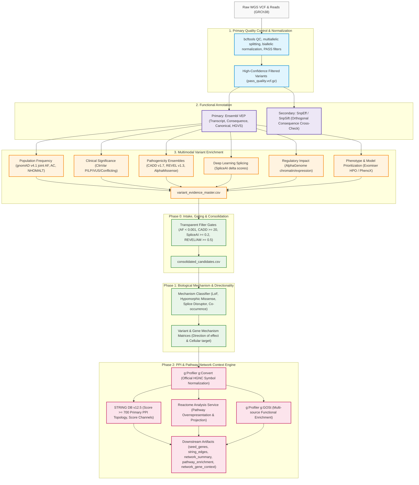
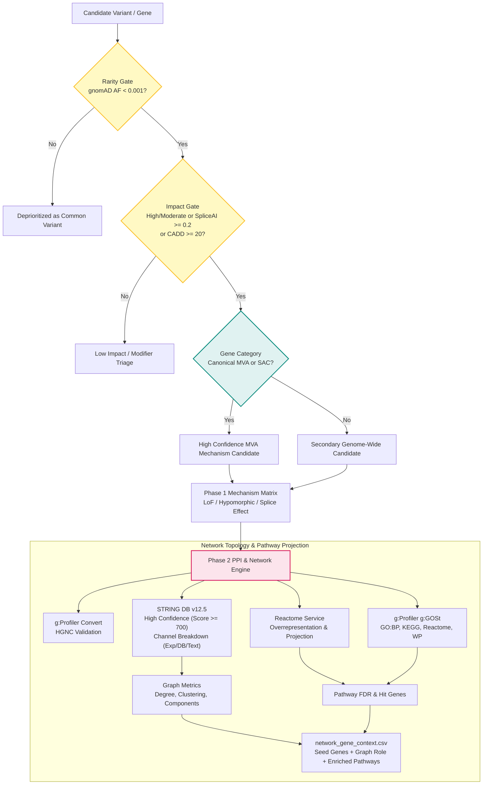

# End-to-End Analytical Journey: From Raw WGS to Pathway Network Context

## Project Mission and Non-Diagnostic Scope

The **Rare Disease, Real Kid: MVA Hackathon 2026** is focused on investigating a real child's whole-genome sequencing (WGS) data presenting with symptoms consistent with **Mosaic Variegated Aneuploidy (MVA)** and related chromosome instability conditions.

> **CRITICAL ETHICAL & RESEARCH NOTICE**
> All analyses, workflows, models, and scripts in this repository are developed strictly for **computational research and candidate exploration**. They do **not** constitute medical advice, diagnostic certainty, or clinical treatment recommendations. All patient and raw genomic data are maintained in private, uncommitted paths per strict repository governance. Computational predictions (e.g., CADD, REVEL, AlphaMissense, SpliceAI, STRING PPI, Reactome) are hypotheses and must be evaluated by clinical geneticists and molecular pathologists.

---

## 1. Complete Analytical Journey Overview

The discovery pipeline follows a layered architecture moving from raw genomic data reduction to biological pathway context without unnecessary reprocessing of heavy upstream stages.

---

## 2. Step-by-Step Analysis, Conclusions & Limitations

### Step 1: Quality Control & Normalization
- **Purpose**: Remove sequencing artifacts, split multiallelic sites, verify read depth (`DP >= 10`), genotype quality (`GQ >= 20`), and retain confident reference calls against GRCh38.
- **Tools**: `bcftools` norm/view, `samtools`, `tabix`.
- **Conclusions**: Normalizing alleles prevents duplicate rows across callers and ensures variant keys (`CHROM:POS:REF:ALT`) align with public databases.
- **Limitations**: Standard germline filters do not resolve low-frequency mosaic variants (low variant allele fractions below 15-20%) without specialized somatic/mosaic callers.

### Step 2: Primary & Secondary Annotation
- **Purpose**: Annotate genomic consequences against Ensembl 116 transcript models (`VEP`) and provide orthogonal verification via `snpEff`.
- **Conclusions**: VEP canonical transcripts provide reproducible gene-level consequences; high/moderate impact captures frameshift, stop-gain, essential splice site, and missense variants.
- **Limitations**: Canonical transcript annotations may not always reflect tissue-specific isoforms critical to kidney, brain, or embryonic development.

### Step 3: Variant-Level Evidence Enrichment
- **Purpose**: Interrogate multiple distinct orthogonal axes of biological deleteriousness:
  - Population rarity (`gnomAD v4.1` with `AF < 0.001` gate).
  - Clinical precedence (`ClinVar` P/LP/VUS/conflicting).
  - Protein-coding pathogenicity (`CADD PHRED >= 20`, `REVEL >= 0.5`, `AlphaMissense >= 0.5`).
  - Deep learning splicing prediction (`SpliceAI delta score >= 0.2`).
  - Regulatory effects (`AlphaGenome`).
  - Phenotypic alignment (`Exomiser` with MVA patient HPO terms).
- **Conclusions**: Single-dimension predictors frequently produce false positives; multi-layer concordance dramatically enriches true functional candidates.
- **Limitations**: In-silico predictors correlate with training databases; they do not constitute independent functional wet-lab proof. SpliceAI offsets are signed distance offsets, not sequencing depth.

### Step 4 (Phase 0): Candidate Intake, Gating & Consolidation
- **Purpose**: Consolidate caller-supplied evidence tables without rerunning upstream tools, applying transparent research triage gates and assigning canonical MVA gene categories (`BUB1B`, `CEP57`, `TRIP13`, `MAD1L1`, `CENATAC`, `SLF2`, `SMC5`).
- **Conclusions**: Produces a clean, non-redundant candidate list (`consolidated_candidates.csv`) with full gating provenance and priority ranking.
- **Limitations**: Pre-defined gene categories can deprioritize novel or uncharacterized causal genes outside established MVA literature.

### Step 5 (Phase 1): Biological Mechanism & Directionality Matrix
- **Purpose**: Characterize functional alteration classes (Null LoF, Hypomorphic Missense, Splice Alteration) and cellular pathway directionality (e.g., impaired SAC arrest $\rightarrow$ precocious mitotic exit $\rightarrow$ random chromosome missegregation).
- **Conclusions**: Evaluates biallelic inheritance requirements (e.g., compound heterozygous LoF + missense in `BUB1B`).
- **Limitations**: In the absence of parental phase information, co-occurring heterozygous variants in the same gene cannot be definitively confirmed as *trans* (compound heterozygous) vs *cis* (same allele) from short reads alone.

### Step 6 (Phase 2): PPI & Pathway Network Context Engine
- **Purpose**: Map candidate genes into system-wide molecular interactomes and functional pathways using external runtime APIs (STRING v12.5, Reactome, g:Profiler).
- **Status**: Implemented and validated against synthetic mocked fixtures (11 unit tests passing). **Not yet executed against the real candidate set** — Phase 0/1 outputs must be generated first, then `scripts/run_network_analysis.sh` queries the live APIs.
- **Expected findings (hypothesis, pending execution)**:
  - Canonical SAC genes (`BUB1B`, `MAD1L1`, `TRIP13`, `TTK`, `AURKB`, `BUB1`, `CDC20`) are expected to form a high-confidence interaction module centered on Mitotic Checkpoint Complex (MCC) assembly and turnover.
  - Spindle assembly checkpoint, mitotic prometaphase, and kinetochore-attachment pathways are expected to dominate overrepresentation results; significance depends on the final seed-gene count.
- **Limitations & Caveats**:
  - **Topology is Non-Directional**: STRING edges and graph clustering indicate association/co-occurrence, *not* pathway directionality (activation vs inhibition) or causal flow.
  - **Not Drug Target Identification**: High network degree or centrality does *not* imply therapeutic suitability or druggability.
  - **Zero Expansion by Default**: Retains focus strictly on input candidates; arbitrary network expansion risks diluting rare disease signal with generic hub proteins (e.g., `UBC`, `TP53`).

---

## 3. Decision & Network Architecture

The following diagram illustrates candidate triage decision logic and downstream network integration:

---

## 4. Privacy, Compliance, and Data Governance

1. **Large Artifacts Stay Out of Git**: Patient WGS VCFs, BAMs, FASTQs, and full evidence tables remain strictly inside `.gitignore` (`data/`, `results/`, `input/`). Only small, deliberately curated candidate-summary tables (e.g., `data/interim/qc/`, `data/interim/*/filtered_csv/`) have been force-added as reviewed results; anything above 8 MB is blocked by the pre-commit hook. Do not commit newly derived patient-level outputs without explicit curation review.
2. **Deterministic Synthetic Testing**: All unit and integration test fixtures are synthetic, deterministic, and non-patient derived. External APIs are mocked in unit test suites.
3. **Responsible API Consumption**: Phase 2 uses polite request throttles (`polite_delay`), clear `User-Agent` headers, exponential backoff retries, and comprehensive error fallback modes.
4. **Provenance Tracking**: Every execution step logs a comprehensive JSON provenance document capturing tool versions, endpoint URLs, query timestamps, parameter thresholds, and explicit interpretation disclaimers.
