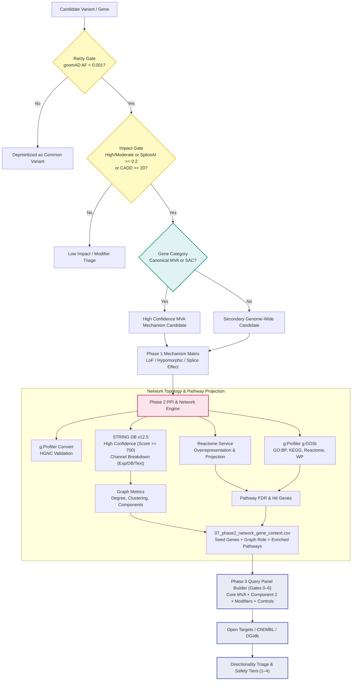
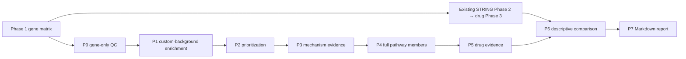

# End-to-End Analytical Journey: From Raw WGS to Pathway Network Context & Pharmacological Evidence

## Project Mission and Non-Diagnostic Scope

The **Rare Disease, Real Kid: MVA Hackathon 2026** is focused on investigating a real child's whole-genome sequencing (WGS) data presenting with symptoms consistent with **Mosaic Variegated Aneuploidy (MVA)** and related chromosome instability conditions.

> **CRITICAL ETHICAL & RESEARCH NOTICE**
> All analyses, workflows, models, and scripts in this repository are developed strictly for **computational research and candidate exploration**. They do **not** constitute medical advice, diagnostic certainty, or clinical treatment recommendations. All patient and raw genomic data are maintained in private, uncommitted paths per strict repository governance. Computational predictions (e.g., CADD, REVEL, AlphaMissense, SpliceAI, STRING PPI, Reactome, Open Targets, ChEMBL, DGIdb) are research hypotheses and must be evaluated by clinical geneticists and molecular pathologists.

---

## 1. Complete Analytical Journey Overview

The discovery pipeline follows a layered architecture moving from raw genomic data reduction to biological pathway context and pharmacological knowledge space without unnecessary reprocessing of heavy upstream stages.

```mermaid
flowchart TD
    classDef rawNode fill:#f9f9f9,stroke:#666,stroke-width:1px;
    classDef prelimNode fill:#e1f5fe,stroke:#0288d1,stroke-width:2px;
    classDef phase0Node fill:#e8f5e9,stroke:#2e7d32,stroke-width:2px;
    classDef phase1Node fill:#fff3e0,stroke:#e65100,stroke-width:2px;
    classDef phase2Node fill:#fce4ec,stroke:#c2185b,stroke-width:2px;
    classDef phase3Node fill:#e8eaf6,stroke:#3f51b5,stroke-width:2px;
    classDef phase4Node fill:#ede7f6,stroke:#512da8,stroke-width:2px,stroke-dasharray: 5 5;

    RawWGS["Raw WGS VCF & Reads (GRCh38)"]:::rawNode

    subgraph Preliminary_Work ["Preliminary Work for Track 2 (Steps 1–3)"]
        S1["Step 1: Primary Quality Control & Normalization<br/>(bcftools norm/view, split multiallelics, DP>=10, GQ>=20)"]:::prelimNode
        S2["Step 2: Functional Consequence Annotation<br/>(Ensembl VEP v116 canonical transcripts + snpEff verification)"]:::prelimNode
        S3["Step 3: Multimodal Variant Evidence Enrichment<br/>(gnomAD v4.1, ClinVar, CADD v1.7, REVEL, AlphaMissense, SpliceAI, AlphaGenome, Exomiser)"]:::prelimNode
        MasterTbl["variant_evidence_master.csv<br/>(Consolidated multi-evidence candidate table)"]:::prelimNode
    end

    subgraph Phase0_Section ["Track 2 — Phase 0: Candidate Intake, Gating & Consolidation"]
        P0_Gate["Transparent Filter Gates<br/>AF <= 0.001, CADD >= 20, SpliceAI >= 0.2, REVEL/AM >= 0.5<br/>Canonical MVA Gene Categorization"]:::phase0Node
        P0_Out["00_phase0_consolidated_candidates.csv<br/>00_phase0_provenance.json"]:::phase0Node
    end

    subgraph Phase1_Section ["Track 2 — Phase 1: Biological Mechanism & Directionality"]
        P1_Engine["Mechanism Classifier & Archetype Fit<br/>LoF Null, Hypomorphic Missense, Splice Disruptor<br/>Direction of Effect & Biallelic Phase Gating"]:::phase1Node
        P1_Out["01_phase1_variant_mechanism_matrix.csv<br/>02_phase1_gene_mechanism_matrix.csv<br/>02_phase1_provenance.json"]:::phase1Node
    end

    subgraph Phase2_Section ["Track 2 — Phase 2: PPI & Pathway Network Context Engine"]
        P2_Engine["Runtime External API Integration<br/>g:Profiler g:Convert (HGNC Symbol Normalization)<br/>STRING DB v12.5 (Score >= 700 High-Confidence PPI)<br/>Reactome Analysis Service & g:Profiler g:GOSt"]:::phase2Node
        P2_Out["03_phase2_seed_genes.csv<br/>04_phase2_string_edges.csv<br/>05_phase2_network_summary.csv<br/>06_phase2_pathway_enrichment.csv<br/>07_phase2_network_gene_context.csv<br/>08_phase2_network_provenance.json<br/>09_phase2_network_nodes.csv<br/>10_phase2_component_summary.csv"]:::phase2Node
    end

    subgraph Phase3_Section ["Track 2 — Phase 3: Query Gene Panel & Drug Repurposing Evidence Engine"]
        P3_Panel["Query Panel Builder (Gates 0–6)<br/>18_phase3_query_gene_panel.csv (80 genes)<br/>19_phase3_query_panel_citations.csv<br/>18_phase3_query_panel_provenance.json"]:::phase3Node
        P3_Engine["Multi-Source Pharmacology Queries<br/>Open Targets Platform v4 GraphQL<br/>ChEMBL v2.0 REST API<br/>DGIdb GraphQL API"]:::phase3Node
        P3_Out["14_phase3_drug_evidence_matrix.csv (2,212 pairs)<br/>15_phase3_safety_ranking.csv (2,006 hypotheses)<br/>16_phase3_mechanism_action_map.csv (80 targets)<br/>17_phase3_repurposing_provenance.json"]:::phase3Node
    end

    subgraph Phase4_Section ["Track 2 — Phase 4 (Proposed): Signed Pathway & Reaction Adjudication"]
        P4_Engine["Phase 4 (proposed): signed pathway/reaction adjudication<br/>Reactome Reactions, SIGNOR, OmniPath<br/>20_phase4_... through 24_phase4_..."]:::phase4Node
    end

    RawWGS --> S1 --> S2 --> S3 --> MasterTbl
    MasterTbl --> P0_Gate --> P0_Out
    P0_Out --> P1_Engine --> P1_Out
    P1_Out --> P2_Engine --> P2_Out
    P2_Out --> P3_Panel --> P3_Engine --> P3_Out
    P3_Out --> P4_Engine
```

---

## 2. Preliminary Work for Track 2 (Steps 1–3)

Before entering Track 2, the raw patient sequencing data underwent foundational quality control, transcript-level consequence annotation, and multi-tool predictive enrichment.

### Step 1: Quality Control & Normalization
- **Purpose**: Remove low-quality sequencing artifacts, decompose complex and multiallelic variants into normalized biallelic records, verify read depth and genotype quality, and retain confident variant calls against GRCh38.
- **Inputs**: Raw WGS VCF (`input/patient/WGS_EX2312012_HGWCNDSX7.vcf.gz`), GRCh38 reference FASTA (`Homo_sapiens.GRCh38.dna.primary_assembly.fa`).
- **Exact Thresholds & Values**:
  - Minimum read depth: `DP >= 10`.
  - Minimum genotype quality: `GQ >= 20`.
  - Filter: `FILTER == "PASS"`.
  - Normalization: `bcftools norm -m -any` (split multiallelic sites) and left-align indels.
- **Outputs**: High-confidence filtered variant VCF (`data/interim/filtered/pass_quality.vcf.gz` and `.tbi`), raw statistics summary (`data/interim/qc/raw_vcf_stats.txt`).
- **Conclusion & Limits**: Allelic normalization produces clean unique coordinate keys (`CHROM:POS:REF:ALT`). However, standard germline filters deprioritize low-frequency somatic mosaic variants (VAF < 15%) without dedicated mosaic callers.

### Step 2: Primary & Secondary Annotation
- **Purpose**: Annotate genomic consequences against Ensembl 116 transcript models (`VEP`) and provide orthogonal verification via `snpEff`.
- **Inputs**: `data/interim/filtered/pass_quality.vcf.gz`, Ensembl VEP 116 cache, snpEff GRCh38 database.
- **Exact Thresholds & Values**:
  - Ensembl VEP flags: `--canonical`, `--hgvs`, `--symbol`, `--biotype protein_coding`, `--numbers`, `--sift b`, `--polyphen b`.
  - Consequence filtering: High and moderate impact variants (frameshift, stop-gained, essential splice donor/acceptor, inframe indel, missense).
- **Outputs**: VEP consequence tables (`data/interim/vep/`), snpEff consequence summaries (`data/interim/snpeff/`).
- **Conclusion & Limits**: Canonical transcripts provide reproducible gene-level consequences, but may miss tissue-specific transcripts critical to neurodevelopment or embryogenesis.

### Step 3: Multimodal Variant Evidence Enrichment
- **Purpose**: Enrich candidate variants across orthogonal axes of biological deleteriousness:
  - Population allele frequency: `gnomAD v4.1` joint AF, AC, AN, NHOMALT.
  - Clinical precedence: `ClinVar` P/LP/VUS/conflicting annotations.
  - Pathogenicity ensembles: `CADD v1.7 PHRED`, `REVEL v1.3`, `AlphaMissense`.
  - Splicing disruption: `SpliceAI` delta scores (`DS_AG`, `DS_AL`, `DS_DG`, `DS_DL`) and position offsets (`DP_*`).
  - Regulatory effects: `AlphaGenome` AVI scores.
  - Phenotypic alignment: `Exomiser` run with patient HPO terms.
- **Outputs**: Unified multi-evidence table (`data/processed/variant_evidence_master.csv`).
- **Conclusion & Limits**: Multi-tool concordance enriches true functional candidates. However, in-silico predictors correlate with common training databases and do not represent wet-lab proof. SpliceAI offsets are signed nucleotide distance offsets, not read coverage.

---

## 3. Track 2 — Phase 0: Candidate Intake, Gating & Consolidation

### Phase Step Relationship & Arrow Chain
$$\text{Upstream Step 3 } (\texttt{variant\_evidence\_master.csv}) \longrightarrow \text{Phase 0 Gating Engine} \longrightarrow \text{Phase 0 Output } (\texttt{00\_phase0\_consolidated\_candidates.csv}) \longrightarrow \text{Phase 1 Mechanism Classifier}$$
*Inputs from Previous Phase*: Consumes the 18,252 enriched variant records from preliminary Step 3.
*Relation to Next Phase*: Delivers 2,215 research-qualified rare, damaging variant candidates to Phase 1 for variant- and gene-level molecular mechanism and directional classification.

### Task & Purpose
Phase 0 ingests the upstream evidence table (`variant_evidence_master.csv`) and optional Exomiser TSVs without rerunning upstream tools. It evaluates each candidate variant against transparent research triage gates, calculates a composite prioritization score, tags multi-hit gene candidates, and classifies genes into canonical MVA/SAC categories.

### Inputs
- Upstream evidence master table: `data/processed/variant_evidence_master.csv`.
- Optional Exomiser variant table: `data/interim/exomiser/mva_patient_exomiser.variants.tsv`.
- Optional Exomiser gene table: `data/interim/exomiser/mva_patient_exomiser.genes.tsv`.

### Exact Thresholds & Logic
1. **Rarity Gate (`GATE_RARITY`)**:
   - `gnomAD_AF <= 0.001` OR `AF_POPULATION <= 0.001` OR allele frequency missing/unobserved in gnomAD.
   - Any variant with `AF >= 0.001` or `gnomAD_NHOMALT >= 5` fails the rarity gate.
2. **Impact Gate (`GATE_IMPACT`)**:
   - High impact consequence (`stop_gained`, `frameshift_variant`, `splice_acceptor_variant`, `splice_donor_variant`, `start_lost`, `stop_lost`) OR
   - Pathogenic/Likely Pathogenic ClinVar status OR
   - `CADD_PHRED >= 20.0` OR
   - `SpliceAI_MAX_DS >= 0.2` OR
   - `REVEL_SCORE >= 0.5` OR
   - `AlphaMissense_AM_SCORE >= 0.5` (or class `likely_pathogenic`).
3. **Overall Pass Gate (`GATE_OVERALL_PASS`)**:
   - Variant passes coordinate check AND (`GATE_RARITY` OR (unknown AF with high consequence in MVA gene)) AND `GATE_IMPACT`.
4. **Gene Categorization**:
   - `CANONICAL_MVA`: `BUB1B`, `CEP57`, `TRIP13`.
   - `REPORTED_MVA_CA`: `MAD1L1`, `CENATAC`.
   - `OVERLAPPING_ATELIS`: `SLF2`, `SMC5`.
   - `SAC_CORE`: `AURKB`, `BUB1`, `BUB3`, `CDC20`, `CENPE`, `MAD2L1`, `PLK1`, `TTK`.
   - `GENOME_WIDE`: All other genes.
   *(Annotation Correction Note: In earlier documentation drafts, CENATAC was informally grouped with Atelis genes. Per `src/mva_hackathon/mva_gene_sets.py` (the codebase source of truth), CENATAC is grouped under `REPORTED_MVA_CA` alongside `MAD1L1`. Phase 0/1 result tables were NOT regenerated for this annotation alignment, preserving exact provenance compatibility).*
5. **Multi-Hit Triage**:
   - Flags genes harboring $\ge 2$ distinct passing candidate variants (`MULTI_HIT_CANDIDATE`).

### Phase 0 Threshold Considerations
| Value / Threshold | Why Used | Consideration / Limitation |
|---|---|---|
| `gnomAD_AF <= 0.001` (0.1%) | Retains alleles rare enough to plausibly cause a severe, early-onset pediatric condition | Filters out common population variation; however, ultra-rare somatic mosaic variants with low VAF might be filtered if calling artifacts mimic low population counts. |
| `gnomAD_NHOMALT < 5` | Deprioritizes alleles seen homozygously in multiple healthy reference individuals | Enforces recessive plausibility; alleles tolerated in homozygous state in healthy adults are improbable severe MVA drivers. |
| High Impact Consequence | Captures unambiguous null variants (stop-gain, frameshift, essential splice donor/acceptor) | High specificity for loss-of-function; cannot detect non-coding regulatory disruptions. |
| `CADD_PHRED >= 20.0` | Selects variants ranked in the top 1% most deleterious across the human genome | Broad genomic coverage; conservative threshold that may deprioritize subtle regulatory hypomorphs. |
| `SpliceAI_MAX_DS >= 0.20` | High-sensitivity cutoff for cryptic splice donor/acceptor loss or gain | Sensitive to deep intronic and exonic splice alterations; predicted score offsets require RNA confirmation. |
| `REVEL >= 0.5` | Standard clinical consensus threshold for damaging missense variants | Highly predictive for missense deleteriousness in coding regions; inapplicable to indels or non-coding variants. |
| `AlphaMissense >= 0.5` | Deep-learning structural constraint predictor for amino acid alterations | Accurately identifies structural destabilization; may yield false negatives in disordered loops. |

### Current Execution Results
- Total variants evaluated: **18,252**
- Total variants passing gates: **2,215**
- Multi-hit candidate genes ($\ge 2$ passing variants): **168**
- Canonical MVA variants passing gates: **6**

### Primary Outputs
- `data/processed/track2/00_phase0_consolidated_candidates.csv` (10.6 MB)
- `data/processed/track2/00_phase0_provenance.json` (1.0 KB)

### Output File Structure: `00_phase0_consolidated_candidates.csv`
- **This provides**: A fully consolidated, gate-audited candidate variant table integrating population frequencies, clinical classifications, and in-silico predictor scores across all 18,252 candidate variants.
- **It answers**: Which candidate variants meet rarity and deleteriousness criteria, which genes harbor multiple hits, and which variants lie in canonical MVA or Spindle Assembly Checkpoint genes.

| Column Name | Description | How to Interpret |
|---|---|---|
| `VARIANT_KEY` | Normalized unique variant key (`CHROM:POS:REF:ALT`) | Unique coordinate identifier across all pipeline stages. |
| `CHROM`, `POS`, `REF`, `ALT` | Genomic coordinates on GRCh38 assembly | Precise physical position and reference/alternate alleles. |
| `SYMBOL` | Official gene symbol from Ensembl canonical transcript | Gene product potentially impacted by the variant. |
| `GATE_COORDINATE` | Boolean validity flag for genomic coordinates | Must be `True`; confirms valid chromosome, positive integer position, and non-empty alleles. |
| `GATE_RARITY` | Boolean pass flag for population allele frequency | `True` indicates variant meets `AF <= 0.001` and `NHOMALT < 5`. |
| `HOMOZYGOTES_IN_POPULATION` | Indicator of observed homozygotes in gnomAD | `True` flags alleles present in homozygous state in reference populations. |
| `GATE_IMPACT` | Boolean pass flag for deleteriousness / consequence | `True` indicates high impact consequence, ClinVar P/LP, or damaging in-silico score. |
| `MVA_BIOLOGICAL_CATEGORY` | Biological classification (`CANONICAL_MVA`, `REPORTED_MVA_CA`, `OVERLAPPING_ATELIS`, `SAC_CORE`, `GENOME_WIDE`) | Highlights canonical checkpoint genes versus genome-wide findings. |
| `GATE_MVA_CONTEXT` | Boolean flag indicating membership in MVA/SAC pathways | `True` prioritizes variants impacting chromosome stability pathways. |
| `GENE_QUALIFYING_HITS` | Total count of distinct passing candidate variants in the same gene | Count $\ge 2$ flags candidate for recessive / compound-heterozygous evaluation. |
| `MULTI_HIT_CANDIDATE` | Boolean indicator for multi-hit genes | `True` indicates gene harbors $\ge 2$ distinct passing variants. |
| `PHASE_STATUS` | Physical phasing annotation | Explicitly tags unphased short-read data (`UNCONFIRMED_PHASE`). |
| `GATE_OVERALL_PASS` | Primary compound filter gate | Primary filter: subset on `True` for the 2,215 qualified research candidates. |
| `GATE_SUMMARY` | Semicolon-delimited summary of passed/failed criteria | Diagnostic string detailing reasons for pass/fail triage. |
| `CONSOLIDATION_PRIORITY_SCORE` | Composite integer priority score (0–100+) | Higher scores reflect multi-evidence concordance and MVA pathway membership. |

### How to Read the Files
- In `00_phase0_consolidated_candidates.csv`:
  - Review `GATE_OVERALL_PASS` to filter for the 2,215 qualified research candidates.
  - Examine `CONSOLIDATION_PRIORITY_SCORE` (higher = higher multi-evidence concordance).
  - Inspect `MVA_GENE_CATEGORY` and `MULTI_HIT_CANDIDATE` to find recessive/compound-het candidates in mitotic pathways.

### Conclusions: Supported vs Unsupported
- **Supported by Evidence**: The candidate intake filter successfully reduces 18,252 raw calls down to 2,215 high-confidence candidate variants, highlighting 168 multi-hit candidate genes and retaining 6 canonical MVA variant calls.
- **NOT Supported / Limitations**: In-silico deleteriousness does **not** prove biochemical pathogenicity. Somatic mosaicism below standard germline sensitivity cannot be assessed without deep targeted sequencing.

---

## 4. Track 2 — Phase 1: Biological Mechanism & Directionality Matrix

### Phase Step Relationship & Arrow Chain
$$\text{Phase 0 Output } (\texttt{00\_phase0\_consolidated\_candidates.csv}) \longrightarrow \text{Phase 1 Mechanism Classifier} \longrightarrow \text{Phase 1 Matrices } (\texttt{01\_variant}, \texttt{02\_gene}) \longrightarrow \text{Phase 2 Network Engine}$$
*Inputs from Previous Phase*: Ingests the 2,215 passing variants and 168 multi-hit genes from Phase 0.
*Relation to Next Phase*: Produces gene-level candidate matrices with passing candidate variant counts, identifying qualifying seed genes ($\ge 1$ passing variant) that feed the Phase 2 STRING interactome and Reactome pathway engines.

### Task & Purpose
Phase 1 builds variant- and gene-level mechanism matrices from Phase 0 candidates. It classifies each variant's molecular mechanism (Loss-of-Function, Hypomorphic Missense, Splice Alteration), predicts cellular pathway consequence directionality, and evaluates whether genes fit compound heterozygous archetypes.

### Inputs
- Phase 0 consolidated candidate table: `data/processed/track2/00_phase0_consolidated_candidates.csv`.

### Exact Thresholds & Logic
1. **Variant Consequence Classification**:
   - `PREDICTED_LOSS_OF_FUNCTION_NULL`: Stop-gain, frameshift, essential splice donor/acceptor, start lost.
   - `PREDICTED_SPLICE_ALTERATION`: SpliceAI max delta score $\ge 0.20$.
   - `HYPOMORPHIC_MISSENSE_SUSPECT`: Missense with `REVEL >= 0.5`, `AlphaMissense >= 0.5`, or `CADD >= 20`.
   - `BENIGN_OR_TOLERATED_PREDICTED`: In-silico scores below damaging thresholds.
   - `VUS_UNCLASSIFIED`: Inconclusive prediction profiles.
2. **Direction of Effect**:
   - Null LoF $\rightarrow$ Complete loss of gene product.
   - Hypomorphic Missense $\rightarrow$ Partial residual activity or domain-specific disruption (e.g., kinase vs kinetochore binding).
   - Splice Alteration $\rightarrow$ Aberrant transcript isoform, exon skipping, or out-of-frame nonsense-mediated decay.
3. **Compound Heterozygous Archetype Fit**:
   - Flags genes harboring $\ge 2$ distinct passing variants, particularly where at least one is LoF and one is hypomorphic missense (the classic MVA `BUB1B` archetype).
4. **Phase Gate Status**:
   - Because patient WGS reads are short-read unphased data, co-occurring variants are explicitly labeled `REQUIRES_PHASE_VERIFICATION` (cannot resolve *cis* vs *trans* without parental trios or long reads).
5. **Biological Mechanism Context for Core Genes**:
   - `BUB1B` (MVA1): Impaired spindle assembly checkpoint $\rightarrow$ premature anaphase onset $\rightarrow$ random chromosome missegregation.
   - `CEP57` (MVA2): Centrosomal microtubule anchoring disruption $\rightarrow$ spindle multipolarity.
   - `TRIP13` (MVA3): Defective MAD2 conformational remodeling $\rightarrow$ checkpoint silencing failure.
   - `MAD1L1` (Reported MVA): Failure of MAD2 kinetochore recruitment $\rightarrow$ uninhibited APC/C activation.
   - `CENATAC` / `CCDC84` (Reported MVA): U12 minor-spliceosome subunit; mutation disrupts minor intron splicing of essential mitotic transcripts $\rightarrow$ chromosome missegregation (note: CENATAC is a spliceosome component, not a structural kinetochore protein; Phase 0/1 result tables were NOT regenerated for this annotation update).
   - `SLF2` / `SMC5` (Atelis syndrome): Impairment of the SMC5/6 structural maintenance complex $\rightarrow$ unresolved replication intermediates and mosaic hyperploidy.

### Phase 1 Threshold Considerations
| Value / Threshold | Why Used | Consideration / Limitation |
|---|---|---|
| Null Consequence Class | Identifies complete loss-of-function alleles | Assumes nonsense-mediated decay (NMD) without direct transcriptomic confirmation. |
| `SpliceAI >= 0.20` | Captures non-canonical splice alterations and cryptic exon usage | Predicts splice probability alterations; does not quantify resultant transcript isoforms. |
| In-silico Missense Damaging Profile | Isolates amino acid changes likely to disrupt protein structure or enzymatic active sites | Predicts deleteriousness, but cannot distinguish between dominant-negative and loss-of-function effects. |
| Multi-hit $\ge 2$ Variants | Identifies candidates fitting autosomal recessive inheritance models | Cannot resolve physical phase (*cis* vs *trans*) from unphased short-read data. |
| `REQUIRES_PHASE_VERIFICATION` | Enforces scientific rigor on co-occurring variants | Explicitly guards against assuming compound heterozygosity before parental segregation is established. |

### Current Execution Results
- Total variants evaluated: **18,252**
- Total genes evaluated: **8,876**
- Canonical MVA genes evaluated: **5**
- Multi-hit candidate genes passing gates: **168**
- Seed genes with $\ge 1$ passing candidate variant: **1,985**

### Primary Outputs
- `data/processed/track2/01_phase1_variant_mechanism_matrix.csv` (9.8 MB)
- `data/processed/track2/02_phase1_gene_mechanism_matrix.csv` (3.8 MB)
- `data/processed/track2/02_phase1_provenance.json` (363 B)

### Output File Structure: `01_phase1_variant_mechanism_matrix.csv`
- **This provides**: A variant-level functional classification table mapping genomic alterations to predicted molecular consequences and cellular pathway directions.
- **It answers**: How each candidate variant alters gene product function (null LoF vs hypomorphic missense vs splice alteration) and its predicted direction of effect.

| Column Name | Description | How to Interpret |
|---|---|---|
| `VARIANT_KEY` | Normalized unique variant key (`CHROM:POS:REF:ALT`) | Unique coordinate identifier across all pipeline stages. |
| `SYMBOL` | Official gene symbol | Affected gene product. |
| `CHROM`, `POS`, `REF`, `ALT` | Genomic coordinates on GRCh38 | Physical location and allele definitions. |
| `HGVS_C`, `HGVS_P` | HGVS coding DNA and protein change annotations | Standardized nomenclature for sequence alterations. |
| `CONSEQUENCE`, `IMPACT` | Sequence Ontology consequence and impact rating | Primary functional effect (e.g. `missense_variant`, `stop_gained`). |
| `VARIANT_CONSEQUENCE_CLASS` | Functional class (`PREDICTED_LOSS_OF_FUNCTION_NULL`, `HYPOMORPHIC_MISSENSE_SUSPECT`, `PREDICTED_SPLICE_ALTERATION`) | Categorizes the molecular consequence on the protein. |
| `PREDICTED_MOLECULAR_DIRECTION` | Inferred molecular direction (e.g. `LOSS_OF_FUNCTION`, `PARTIAL_ACTIVITY_LOSS`) | Expected directional effect on protein activity. |
| `PATHWAY`, `BIOLOGICAL_ROLE` | Annotated cellular pathway and physiological function | Contextualizes the target within spindle or genome stability networks. |
| `MVA_MECHANISM_LINK` | Specific biological link to MVA cellular phenotype | Explains whether target relates to checkpoint, centrosome, or splicing biology. |
| `CANONICAL_PATHWAY_DIRECTION` | Normal biological function (e.g. `PROMOTES_SAC_ARREST`) | Physiological role of the unmutated gene product. |
| `THERAPEUTIC_DIRECTIONALITY` | Desired direction of therapeutic modulation (e.g. `RESTORE_SAC_ACTIVITY`) | Directional intent required to rescue the mutant phenotype. |
| `INHERITANCE_REQUIREMENT` | Expected disease inheritance model (e.g. `AUTOSOMAL_RECESSIVE`) | Genetic model required for disease manifestation. |
| `GATE_OVERALL_PASS` | Phase 0 filter status | `True` indicates candidate passed Phase 0 intake triage. |
| `CONSOLIDATION_PRIORITY_SCORE` | Upstream composite evidence score | Priority rank based on multi-tool concordance. |

### Output File Structure: `02_phase1_gene_mechanism_matrix.csv`
- **This provides**: A gene-level consolidation aggregating variant counts per gene, compound heterozygous archetype fit, and phase verification requirements.
- **It answers**: Which candidate genes meet seed criteria ($\ge 1$ passing variant) for network analysis, which genes fit the classic MVA compound heterozygous archetype, and whether phase verification is required.

| Column Name | Description | How to Interpret |
|---|---|---|
| `SYMBOL` | Official gene symbol | Unique gene identifier. |
| `GENE_NAME` | Full descriptive gene name | Complete biological nomenclature. |
| `PATHWAY`, `BIOLOGICAL_ROLE` | Cellular pathway and physiological role | Functional domain of the gene product. |
| `MVA_MECHANISM_LINK` | Mechanistic relationship to MVA pathogenesis | Core checkpoint vs modifier vs secondary finding. |
| `TOTAL_VARIANTS_EVALUATED` | Total variants detected in gene prior to filtering | Baseline variant burden in patient. |
| `TOTAL_PASSING_CANDIDATE_VARIANTS` | Total variants passing Phase 0 research gates | $\ge 1$ qualifies gene as a seed for Phase 2 network analysis. |
| `PASSING_CONSEQUENCE_SPECTRUM` | Semicolon-delimited consequence classes among passing variants | Spectrum of functional hits (e.g. Null + Missense). |
| `COMPOUND_HET_ARCHETYPE_FIT` | Boolean flag for classic compound heterozygous profile | `True` indicates co-occurrence of null and missense/splice hits. |
| `ARCHETYPE_DESCRIPTION` | Detailed classification of multi-hit archetype | Classifies pattern (e.g. `CLASSIC_MVA_ARCHETYPE`). |
| `PHASE_GATE_STATUS` | Phasing status (`REQUIRES_PHASE_VERIFICATION` vs `SINGLE_HIT`) | Explicitly notes whether *cis*/*trans* testing is required. |
| `MAX_CONSOLIDATION_PRIORITY_SCORE` | Maximum priority score among variants in this gene | Identifies top-scoring candidate genes. |
| `TOP_VARIANT_KEYS` | Semicolon-delimited list of passing variant keys | Specific variant coordinates driving gene selection. |

### How to Read the Files
- In `01_phase1_variant_mechanism_matrix.csv`:
  - Inspect `VARIANT_CONSEQUENCE_CLASS` and `PREDICTED_MOLECULAR_DIRECTION` for each variant's functional impact.
- In `02_phase1_gene_mechanism_matrix.csv`:
  - Filter for `TOTAL_PASSING_CANDIDATE_VARIANTS >= 1` to find seed genes.
  - Check `COMPOUND_HET_ARCHETYPE_FIT` for recessive candidates. Note `PHASE_GATE_STATUS` requirements.

### Conclusions: Supported vs Unsupported
- **Supported by Evidence**: Categorizes variants into functional consequence classes consistent with MVA biology; identifies recessive compound heterozygous candidates matching known MVA disease archetypes.
- **NOT Supported / Limitations**: Cannot confirm physical *trans* phasing without parental sequencing. Predicted direction of effect is computational and does not establish cellular enzyme kinetics.

---

## 5. Track 2 — Phase 2: PPI and Pathway Network Context Engine

### Phase Step Relationship & Arrow Chain
$$\text{Phase 1 Output } (\texttt{02\_phase1\_gene\_mechanism\_matrix.csv}) \longrightarrow \text{Phase 2 Network Engine (STRING v12.5 / Reactome / g:Profiler)} \longrightarrow \text{Phase 2 Topology Outputs (03–13)} \longrightarrow \text{Phase 3 Query Panel Builder}$$
*Inputs from Previous Phase*: Consumes the 1,985 seed genes harboring $\ge 1$ passing candidate variant from Phase 1.
*Relation to Next Phase*: Identifies the MVA-focus interactome connected component (Component 2: 37 nodes, 52 edges anchoring `BUB1B`, `MAD1L1`, `MAD2L2`), which directly seeds Gate 2 (Graph-Derived Neighbors) of the Phase 3 Query Gene Panel Builder.

### Task & Purpose
Phase 2 maps passing candidate genes into interactome topologies and biological pathways using live runtime queries to external biomedical databases (STRING DB v12.5, Reactome Analysis Service, and g:Profiler).

### Inputs
- Phase 1 gene mechanism matrix: `data/processed/track2/02_phase1_gene_mechanism_matrix.csv`.
- Optional Phase 1 variant mechanism matrix: `data/processed/track2/01_phase1_variant_mechanism_matrix.csv`.

### Exact Parameters & API Configuration
1. **Seed Gene Gating (`min_passing = 1`)**:
   - Evaluates only genes with $\ge 1$ passing candidate variant from Phase 0 / Phase 1.
2. **Gene Symbol Normalization**:
   - g:Profiler `g:Convert` maps input symbols to official HGNC symbols against organism `hsapiens`.
3. **STRING Database v12.5**:
   - Endpoint: `https://version-12-5.string-db.org/api/json/network`.
   - Confidence threshold: `required_score = 700` (High confidence).
   - Additional interactors: `additional_nodes = 0` (Zero expansion: strict candidate focus).
   - Batch size: 300 symbols per request (avoids HTTP GET URI truncation).
   - Evidence channels captured: experimental score (`escore`), curated database (`dscore`), textmining (`tscore`), coexpression (`ascore`), and combined confidence score (`score`).
4. **Reactome Pathway Analysis Service**:
   - Endpoint: `https://reactome.org/AnalysisService/identifiers/projection`.
   - Maps seed genes onto human curated pathways; retrieves top pathways ranked by overrepresentation FDR.
5. **g:Profiler g:GOSt Functional Enrichment**:
   - Endpoint: `https://biit.cs.ut.ee/gprofiler/api/gost/profile/`.
   - Data sources: `GO:BP` (Biological Process), `REAC` (Reactome), `KEGG`, `HP` (Human Phenotype Ontology), `WP` (WikiPathways).
   - Statistical threshold: `user_threshold = 0.05` (g:SCS multiple testing correction).

### Current Execution Results
The live execution completed with complete provenance recorded:
- **18,252** variants evaluated in upstream stages.
- **2,215** variants passed Phase 0 research gates.
- **1,985** seed genes qualified (each with $\ge 1$ passing candidate variant).
- **1,985** seed genes successfully mapped to official HGNC symbols via g:Convert.
- **477** high-confidence PPI edges identified in STRING DB v12.5 (combined score $\ge 0.700$).
- **84** significantly enriched biological pathway terms identified across Reactome and g:GOSt (FDR $< 0.05$).
- Global interactome metrics:
  - Average network degree: 0.48
  - Connected components: 1,600
  - Largest connected component: 111 genes (Component 1, 42 core nodes + subgraphs)
  - MVA-focused connected component (Component 2): 37 genes, 52 edges (anchors `BUB1B`, `MAD1L1`, `MAD2L2`)
  - Isolated singleton genes: 1,595 genes

### Primary Outputs
- `data/processed/track2/03_phase2_seed_genes.csv` (728 KB)
- `data/processed/track2/04_phase2_string_edges.csv` (51 KB)
- `data/processed/track2/05_phase2_network_summary.csv` (283 B)
- `data/processed/track2/06_phase2_pathway_enrichment.csv` (62 KB)
- `data/processed/track2/07_phase2_network_gene_context.csv` (823 KB)
- `data/processed/track2/08_phase2_network_provenance.json` (2.6 KB)
- `data/processed/track2/09_phase2_network_nodes.csv` (435 KB)
- `data/processed/track2/10_phase2_component_summary.csv` (5.8 KB)
- `data/processed/track2/11_phase2_largest_component.html` (47 KB)
- `data/processed/track2/12_phase2_mva_focus_network.html` (43 KB)
- `data/processed/track2/13_phase2_pathway_enrichment.html` (54 KB)

### Output File Structures for Phase 2 CSVs

#### `03_phase2_seed_genes.csv`
- **This provides**: The complete mapped roster of the 1,985 candidate seed genes qualifying from Phase 1.
- **It answers**: Which candidate genes successfully mapped to official HGNC symbols and what their baseline variant burdens are.

| Column Name | Description | How to Interpret |
|---|---|---|
| `INPUT_SYMBOL`, `HGNC_SYMBOL` | Input gene symbol and standardized HGNC symbol | Confirms identifier mapping fidelity. |
| `HGNC_STATUS` | Mapping status (`mapped` vs `unmapped`) | Confirms valid human protein-coding gene entity. |
| `DESCRIPTION` | Official HGNC gene description | High-level summary of gene function. |
| `PATHWAY`, `MVA_MECHANISM_LINK` | Annotated pathway and relationship to MVA phenotype | Cellular context from baseline knowledge base. |
| `TOTAL_PASSING_CANDIDATE_VARIANTS` | Count of passing candidate variants in patient | Genetic evidence supporting seed selection. |
| `COMPOUND_HET_ARCHETYPE_FIT` | Compound heterozygous archetype indicator | Identifies recessive candidate seeds. |

#### `04_phase2_string_edges.csv`
- **This provides**: High-confidence physical and functional protein-protein interaction edges among seed genes from STRING DB v12.5.
- **It answers**: Which candidate gene products interact physically or functionally, with exact score breakdowns across experimental, curated database, and textmining channels.

| Column Name | Description | How to Interpret |
|---|---|---|
| `PREFERRED_NAME_A`, `PREFERRED_NAME_B` | Interacting gene symbol pair | Identified protein-protein interaction partners. |
| `STRING_ID_A`, `STRING_ID_B` | Ensembl protein identifiers in STRING database | Database-stable protein keys. |
| `SCORE` | Combined STRING interaction confidence score (0–1000) | Values $\ge 700$ denote high confidence. |
| `EXPERIMENTAL_SCORE`, `DATABASE_SCORE` | Channel scores for experimental assays and curated databases | Sub-scores indicating primary wet-lab evidence. |
| `TEXTMINING_SCORE`, `COEXPRESSION_SCORE` | Channel scores for literature textmining and coexpression | Supporting associative evidence channels. |
| `CURATED_SUPPORT` | Boolean flag indicating experimental or database support | `True` indicates interaction is backed by direct evidence. |

#### `05_phase2_network_summary.csv`
- **This provides**: Global topological summary metrics of the seed gene interactome.
- **It answers**: What the global density, connectivity, average degree, and modularity of the patient candidate interactome are.

| Column Name | Description | How to Interpret |
|---|---|---|
| `METRIC` | Name of topological property (e.g. `Total Edges`, `Average Degree`) | Global network metric descriptor. |
| `VALUE` | Computed numerical value for the seed interactome | Quantitative graph metric. |
| `DESCRIPTION` | Narrative explanation of the topological metric | Guides biological interpretation of network structure. |

#### `06_phase2_pathway_enrichment.csv`
- **This provides**: Statistically significant biological pathway terms overrepresented among candidate genes across Reactome and g:Profiler.
- **It answers**: Which cellular pathways and biological processes are significantly enriched at FDR $< 0.05$.

| Column Name | Description | How to Interpret |
|---|---|---|
| `SOURCE_DATABASE` | Pathway database (`Reactome`, `GO:BP`, `KEGG`, `WP`, `HP`) | Source ontology or pathway repository. |
| `PATHWAY_ID`, `PATHWAY_NAME` | Accession identifier and official pathway title | Specific biological pathway tested. |
| `ENTITIES_FOUND`, `ENTITIES_TOTAL` | Number of candidate genes in pathway vs pathway size | Overlap proportion between seeds and pathway. |
| `P_VALUE`, `FDR` | Raw hypergeometric p-value and FDR-adjusted q-value | Statistical significance (FDR $< 0.05$ threshold). |
| `HIT_GENES` | Semicolon-delimited list of candidate genes hitting pathway | Identifies which candidate genes drive pathway enrichment. |

#### `07_phase2_network_gene_context.csv`
- **This provides**: A unified synthesis table combining Phase 1 variant mechanism metrics with Phase 2 interactome topology and pathway memberships.
- **It answers**: For any candidate gene, its network centrality, clustering coefficient, interaction partners, and top enriched pathways.

| Column Name | Description | How to Interpret |
|---|---|---|
| `HGNC_SYMBOL` | Official gene symbol | Unique candidate identifier. |
| `NETWORK_DEGREE` | Total high-confidence PPI edges connecting this gene | Degree $>0$ denotes interconnected network membership. |
| `CLUSTERING_COEFFICIENT` | Local neighborhood clustering density (0.0–1.0) | High values denote tightly interconnected functional modules. |
| `COMPONENT_ID` | Connected component identifier | Distinguishes connected subgraphs from isolated singletons. |
| `IS_ISOLATED` | Boolean indicator for singleton status | `True` indicates gene has zero edges at score $\ge 700$. |
| `STRING_INTERACTORS` | Semicolon-delimited list of connected partner genes | Direct physical and functional interactors. |
| `TOP_ENRICHED_PATHWAYS` | Top enriched biological pathways containing this gene | Cellular pathways linking gene to patient phenotype. |

#### `09_phase2_network_nodes.csv`
- **This provides**: Node-level topological metrics for all 1,989 evaluated gene symbols.
- **It answers**: Which connected component each gene belongs to, its degree, isolation status, and MVA canonical/extended membership.

| Column Name | Description | How to Interpret |
|---|---|---|
| `HGNC_SYMBOL`, `INPUT_SYMBOL` | Official HGNC and input gene symbols | Node identity in the interactome. |
| `NETWORK_DEGREE` | Total high-confidence edges connected to this node | Hubness / local network centrality. |
| `COMPONENT_RANK` | Size-ranked connected component index | Component 2 identifies the MVA-focus module. |
| `IS_ISOLATED` | Isolation indicator | `True` denotes isolated singletons (degree 0). |
| `MVA_CANONICAL`, `MVA_EXTENDED` | Boolean flags for canonical or extended MVA gene status | Highlights core chromosome stability genes. |

#### `10_phase2_component_summary.csv`
- **This provides**: Structural and biological summaries across all 124 multi-node connected components.
- **It answers**: Which components contain known MVA genes, their node and edge counts, graph density, and full gene rosters.

| Column Name | Description | How to Interpret |
|---|---|---|
| `COMPONENT_RANK` | Component index ordered by node count | Component 1 is largest; Component 2 is MVA-focus. |
| `COMPONENT_SIZE`, `EDGE_COUNT` | Number of nodes and edges in the component | Scale and connectivity of the subgraph. |
| `DENSITY` | Subgraph density ($2E / [N(N-1)]$) | Topological tightness of the functional module. |
| `HAS_MVA_KNOWN_GENE` | Boolean indicator for known MVA gene presence | `True` flags components containing MVA causal genes. |
| `MVA_GENES` | Semicolon-delimited list of MVA genes in component | MVA anchors within this component. |
| `GENE_LIST` | Semicolon-delimited list of all gene symbols in component | Complete gene membership roster. |

### How to Read the Files
- In `05_phase2_network_summary.csv` & `10_phase2_component_summary.csv`: Review global topological metrics (edge counts, average degree, component sizes, densities, and MVA gene membership).
- In `04_phase2_string_edges.csv`: Inspect specific physical and functional protein-protein interactions, score breakdowns (database vs experimental vs textmining), and confidence ratings.
- In `06_phase2_pathway_enrichment.csv` & `13_phase2_pathway_enrichment.html`: Examine statistically overrepresented biological pathways, FDR values, and interactive bubble charts colored by source database.
- In `07_phase2_network_gene_context.csv` & `09_phase2_network_nodes.csv`: For any candidate gene of interest, find its unified row containing network degree, component rank, clustering coefficient, interaction partners, and enriched pathways.
- In `11_phase2_largest_component.html`: Explore the largest connected interactome component (Component 1, 42 genes, 64 edges) centered on general cellular machinery (splicing, translation, transcription regulation).
- In `12_phase2_mva_focus_network.html`: Explore the MVA-focused candidate component (Component 2, 37 genes, 52 edges) directly connecting `BUB1B`, `MAD1L1`, and `MAD2L2` to spindle assembly checkpoint and genome stability networks (`TP53`, `ATM`, `DDX11`, `NF1`).
- In `08_phase2_network_provenance.json`: Inspect exact execution timestamps, API URLs, versions, parameter thresholds, and the Reactome live projection token.

### Conclusions: Supported vs Unsupported
- **Supported by Evidence**: Candidate genes assemble into focused functional modules; Component 2 (37 genes, 52 edges) links core MVA genes (`BUB1B`, `MAD1L1`, `MAD2L2`) to cell cycle and genome maintenance regulators (`TP53`, `ATM`, `NF1`).
- **NOT Supported / Limitations**: STRING PPI associations denote physical binding or co-annotation, **not** directional pathway signaling or causal disease flow. High network degree does not indicate therapeutic target suitability.

---

## 6. Track 2 — Phase 3: Query Gene Panel & Multi-Source Drug Repurposing Evidence Engine

### Phase Step Relationship & Arrow Chain
$$\text{Phase 2 Outputs } (\texttt{Component 2}, \texttt{07\_context}, \texttt{04\_edges}) + \text{Phase 1} \longrightarrow \text{Phase 3 Panel Builder (Gates 0–6)} \longrightarrow \text{Query Panel } (\texttt{18\_panel}, \texttt{19\_citations}) \longrightarrow \text{Pharmacology Queries} \longrightarrow \text{Repurposing Matrices (14–17)} \longrightarrow \text{Phase 4}$$
*Inputs from Previous Phase*: Consumes the programmatically detected MVA-focus component (Component 2: 37 nodes, 52 edges) from Phase 2, candidate mechanism annotations from Phase 1, and STRING high-confidence edges.
*Relation to Next Phase*: Filters and prioritizes drug-target evidence into safety tiers, identifying Tier 1/2 candidates and multi-source supported interactions that feed the proposed Phase 4 signed reaction and causal adjudication engine.

### The Seed-Provenance Correction Story
In the initial development cycle (committed earlier in repository history), Phase 3 utilized a hard-coded 13-gene list defined as `EXPANDED_MVA_NETWORK_SEEDS` (`BUB1B`, `CEP57`, `TRIP13`, `MAD1L1`, `CENATAC`, `SLF2`, `SMC5`, `TP53`, `ATM`, `NF1`, `MAD2L2`, `AURKA`, `PLK1`) within `src/mva_hackathon/drug_evidence.py`. While clinically informed by literature, this seed list was:
1. An expert/literature prior rather than an interactome-derived panel.
2. Intersected strictly with Phase 1 passing availability (`TOTAL_PASSING_CANDIDATE_VARIANTS >= 1`), which caused `CEP57`, `TRIP13`, and `PLK1` to be dropped because this specific patient harbored no passing variants in those genes.
3. As a result, only 10 genes were actually queried against pharmacological APIs.

Labeling that earlier mode `mva_network` was misleading because it was neither derived from the Phase 2 network graph nor did it include the full interactome neighborhood. To establish true computational rigor, the codebase was refactored:
- `src/mva_hackathon/query_gene_panel.py` was introduced to dynamically construct a rigorous 80-gene panel (`18_phase3_query_gene_panel.csv`) directly from the Phase 2 graph topology.
- `src/mva_hackathon/drug_evidence.py` was updated to consume this graph-grounded panel dynamically (`--seed-mode query_panel`).
- The earlier 10-gene mode was retained strictly as an optional backward-compatible fallback, and all documentation was corrected.

### The Graph-Derived Query Gene Panel: Multi-Gate Selection Architecture
The Phase 3 Query Gene Panel Builder applies six sequential, transparent selection gates to derive an 80-gene query panel:

1. **Gate 0: Symbol Hygiene & Non-Query Quarantine**:
   - Enforces HGNC `'mapped'` status; quarantines unmapped identifiers, complex `HLA-*` immune genes, read-through/non-coding transcripts containing hyphens, and pseudogenes into a logged dropped ledger (`gate0_dropped_ledger_counts`).
2. **Gate 1: Core MVA Causal Inclusion (`CORE_MVA_CAUSAL`)**:
   - All 7 established core MVA and chromosome instability causal genes (`BUB1B`, `CEP57`, `TRIP13`, `CENATAC`, `MAD1L1`, `SLF2`, `SMC5`) are **always** included.
   - Crucially, `CEP57` and `TRIP13` are injected even though they have zero passing candidate variants in this patient's Phase 1 matrix. They are flagged with `EVIDENCE_GAP_FLAGS = PHASE1_ABSENT`.
   - *Rationale*: Known monogenic MVA causal genes must never be silently omitted from therapeutic repurposing exploration; lack of a patient variant does not preclude baseline pathway deficit or compensatory modulation.
3. **Gate 2: Graph-Derived Interactome Neighbors (`GRAPH_DERIVED_NEIGHBOR`)**:
   - Programmatically detects the MVA-focus connected component by searching for core causal anchors (`BUB1B`, `MAD1L1`, `TRIP13`, `CEP57`, etc.) without hardcoding component rank.
   - Accurately detects **Component Rank 2** (37 nodes, 52 edges).
   - Ingests all non-core members of Component 2. Evaluates topological distance to core anchors using STRING edges ($\ge 0.700$): classifies nodes into `ONE_HOP_OF_CORE` versus `TWO_HOP_OR_COMPONENT_MEMBER`.
   - Prefers interactions with curated database support (`CURATED_SUPPORT`). Enforces a strict zero-expansion policy (`additional_nodes = 0`) to prevent runaway graph inflation.
4. **Gate 3: Context Modifiers (`CONTEXT_MODIFIER`)**:
   - Selects candidate genes harboring qualified Phase 1/2 candidate variants meeting compound-het archetype fit, $\ge 2$ passing variants, or membership in enriched mitotic/chromosome segregation pathways (`MITOTIC_KW_REGEX`).
   - Capped at 25 genes.
   - Explicitly incorporates 4 manually-curated literature context genes (`TP53`, `ATM`, `NF1`, `MAD2L2`) labeled as `CURATED_CONTEXT` and explicitly classified as **NON-MVA-causal secondary disease/cancer predisposition context**.
5. **Gate 4: Drug-Target Controls (`DRUG_TARGET_CONTROL`)**:
   - **Positive Controls (9 genes)**: `AURKA`, `PLK1`, `BUB1`, `CDC20`, `MAD2L1`, `PLK4`, `ATR`, `CHEK1`, `WEE1`. These are well-characterized mitotic and checkpoint kinases/regulators with established pharmacological inhibitors/modulators, verifying API connectivity and retrieval sensitivity.
   - **Negative Controls (4 genes)**: Programmatically derived isolated non-mitotic olfactory receptor genes (`OR7G3`, `OR10AD1`, `OR10D3`, `OR10X1`) from the candidate set with zero interactors (`IS_ISOLATED = True`) and no mitotic keyword annotations. Expected to return zero drug hits.
   - All 4 negative controls returned zero drug rows as expected; 7 of 9 positive controls returned hits (`AURKA` 123, `PLK1` 206, `BUB1` 6, `PLK4` 41, `ATR` 37, `CHEK1` 70, `WEE1` 20 rows), while `CDC20` and `MAD2L1` returned zero hits across public APIs (`WARNING_ZERO_HITS` recorded in provenance).
6. **Gate 5 & 6: Deduplication, Precedence & Sizing Caps**:
   - Enforces strict hierarchical precedence during deduplication: `CORE_MVA_CAUSAL` $>$ `GRAPH_DERIVED_NEIGHBOR` $>$ `CONTEXT_MODIFIER` $>$ `DRUG_TARGET_CONTROL` (a control only receives the control category if the gene was not already selected by Gates 1–3).
   - Asserts total panel size $\le 120$ genes (resolved to exactly **80 genes**).

### Query Panel Category Semantics
- `CORE_MVA_CAUSAL`: Established or reported monogenic causal genes for Mosaic Variegated Aneuploidy or Atelis syndrome (direct disease etiology).
- `GRAPH_DERIVED_NEIGHBOR`: Physical or functional interactors within the MVA-focus interactome component (association and network topology, **not** causal claims).
- `CONTEXT_MODIFIER`: Secondary genome-wide candidates, compound-het archetypes, pathway modifiers, or curated cancer-predisposition genes modifying phenotypic severity or cancer risk.
- `DRUG_TARGET_CONTROL`: Benchmark targets included to verify API coverage, assay sensitivity, and false-positive baseline (positive vs negative controls).

### Literature Provenance Policy & Verification Audit
To ensure absolute scientific traceability and prevent citation fabrication:
- **NCBI E-utilities Live Verification**: Primary literature references were verified against PubMed via NCBI E-utilities (`esearch` + `esummary`). **20 entries verified, 0 pending**. Strict regex validation enforced for DOI (`10.\d{4,9}/\S+`) and PMID (`^\d+$`).
- **Core-Gene OMIM Disease Entities**:
  - `BUB1B` (MVA1): OMIM `#257300`
  - `CEP57` (MVA2): OMIM `#614114`
  - `TRIP13` (MVA3): OMIM `#617598`
  - `CENATAC` (CCDC84, Reported MVA): OMIM `#620153`
  - `MAD1L1` (Reported MVA): OMIM `#620189`
  - `SLF2` (Atelis syndrome 1): OMIM `#620184`
  - `SMC5` (Atelis syndrome 2): OMIM `#620185`
- **Graph-Derived Neighbor Provenance**: Graph-derived neighbors cite versioned STRING v12.5 and Reactome pathway URLs as `GRAPH_INDIRECT` evidence (database citation, **not** a disease claim).
- **Integrity Rule**: Empty strings (`""`) are used for unverified or non-applicable fields; identifiers are never guessed. Evidence gap flags (`NO_PMID`, `NO_DOI`, `GRAPH_ONLY`, `PHASE1_ABSENT`, `NO_OMIM`, `NO_MECHANISM_KB`) are explicitly recorded in provenance ledgers.

### Multi-Source Pharmacology Retrieval & Safety Tiering Logic
Phase 3 queries three authoritative pharmacological knowledge sources across the 80 panel targets:
1. **Open Targets Platform v4 GraphQL**: Clinical developmental stages, target tractability, approved indications, and curated safety liabilities.
2. **ChEMBL v2.0 REST API**: Curated drug mechanisms of action, maximum clinical trial phases, and target classifications.
3. **DGIdb GraphQL API**: Broad drug-gene interaction aggregator across public biomedical literature and chemogenomic sources.

Each retrieved drug-target pair is evaluated for mechanistic directionality:
$$\text{Variant Defect (LoF / SAC Impairment)} \longrightarrow \text{Target Action (Inhibition vs Activation)} \longrightarrow \text{Safety & Directional Fit}$$

Hypotheses are categorized into four safety tiers:
- **Tier 1: Concordant Hypothesis (`TIER_1_CONCORDANT_HYPOTHESIS`)**: Compounds whose pharmacological action (activation, stabilization, or expression enhancement) matches the desired biological direction of effect (e.g. TP53 stabilizers or gene replacement).
- **Tier 2: Off-Target Mitotic Compensation (`TIER_2_OFF_TARGET_COMPENSATION`)**: Mitotic inhibitors (e.g., AURKA, PLK1 inhibitors) that induce synthetic lethality in aneuploid cells but present severe pediatric toxicity risks in developing normal tissues.
- **Tier 3: Uncertain Directionality (`TIER_3_UNCERTAIN_DIRECTIONALITY`)**: Compounds with non-directional binding, uncharacterized functional modulation, or ambiguous assay records.
- **Tier 4: Contraindicated Hazard (`TIER_4_CONTRAINDICATED_HAZARD`)**: Compounds whose action directly exacerbates baseline pathology (e.g., administering a checkpoint inhibitor against an already broken spindle assembly checkpoint). Flagged with `CONTRADICTION_FLAG = True` and relegated to the bottom of research rankings.

### Execution Results: Re-Run Metrics
The re-run using the graph-derived 80-gene panel produced the following verified metrics:
- **Query Gene Panel Breakdown (80 genes)**:
  - `CORE_MVA_CAUSAL`: **7** genes
  - `GRAPH_DERIVED_NEIGHBOR`: **31** genes
  - `CONTEXT_MODIFIER`: **29** genes (including 4 curated literature context genes: `TP53`, `ATM`, `NF1`, `MAD2L2`)
  - `DRUG_TARGET_CONTROL`: **13** genes (`CONTROL_ROLE`: **9 POSITIVE**, **4 NEGATIVE**)
- **Pharmacological Retrieval Results**:
  - Total drug-target evidence pairs retrieved: **2,212**
    - `DGIdb`: **1,898** pairs (~85.8%)
    - `Open Targets Platform v4`: **161** pairs (~7.3%)
    - `ChEMBL v2.0`: **153** pairs (~6.9%)
  - Total unique drug-target hypotheses ranked: **2,006**
- **Safety & Directionality Tier Distribution**:
  - `TIER_3_UNCERTAIN_DIRECTIONALITY`: **1,891** hypotheses
  - `TIER_2_OFF_TARGET_COMPENSATION`: **99** hypotheses
  - `TIER_4_CONTRAINDICATED_HAZARD`: **11** hypotheses
  - `TIER_1_CONCORDANT_HYPOTHESIS`: **5** hypotheses
- **Contradiction & Hazard Flags**:
  - **15** mechanistic-hazard / contradiction records flagged in the evidence matrix (`CONTRADICTION_FLAG = True`).
- **Target Coverage & Zero-Hit Targets**:
  - **38 of 80** genes returned ZERO drug evidence across all queried databases (`RESEARCH_STATUS = NO_DRUG_EVIDENCE`).
- **Control Performance Outcomes**:
  - **Negative Controls (4/4 passed)**: `OR10G4`, `OR2T33`, `OR4K2`, `OR5D18` all returned 0 drug hits as expected (`PASS_ZERO_HITS`).
  - **Positive Controls (7/9 returned hits)**: `AURKA` (123 hits), `PLK1` (206 hits), `BUB1` (6 hits), `PLK4` (41 hits), `ATR` (37 hits), `CHEK1` (70 hits), `WEE1` (20 hits).
  - Two positive controls (`CDC20` and `MAD2L1`) returned 0 hits across public APIs, logged with `WARNING_ZERO_HITS` in provenance (reflecting absence of small-molecule inhibitor records in current public APIs rather than pipeline failure).

### Database Coverage Interpretation & Biological Insights
1. **DGIdb Dominance (~86%)**: The evidence base is heavily dominated by DGIdb because it aggregates diverse literature mining, chemogenomic repositories, and clinical trials. Open Targets and ChEMBL provide smaller, highly curated subsets with formal tractability and clinical phases.
2. **Direct Pharmacology for Core MVA Genes is Sparse or Absent**: `CEP57`, `TRIP13`, `SLF2`, `SMC5`, and `CENATAC` are among the 38 targets with zero or sparse drug evidence.
3. **Expected Biological Result**: Sparse direct pharmacology for core MVA genes is an **expected biological finding**, not a computational defect. Structural kinetochore anchors, centrosomal proteins, and minor spliceosome components lack conventional druggable active pockets for small-molecule stimulation.
4. **Motivation for Phase 4**: Because direct target druggability for core MVA genes is largely unavailable, therapeutic hypotheses must shift to the **pathway and reaction level** (e.g. compensatory replication stress pathways, synthetic lethality in aneuploid cells, or mitotic arrest modulators), motivating the proposed Phase 4 adjudication layer.

### Primary Outputs
- `data/processed/track2/18_phase3_query_gene_panel.csv` (122 KB)
- `data/processed/track2/18_phase3_query_panel_provenance.json` (1.9 KB)
- `data/processed/track2/19_phase3_query_panel_citations.csv` (29 KB)
- `data/processed/track2/14_phase3_drug_evidence_matrix.csv` (1.55 MB)
- `data/processed/track2/15_phase3_safety_ranking.csv` (953 KB)
- `data/processed/track2/16_phase3_mechanism_action_map.csv` (33 KB)
- `data/processed/track2/17_phase3_repurposing_provenance.json` (13 KB)

### Output File Structure: `18_phase3_query_gene_panel.csv`
- **This provides**: The complete, 80-gene multi-tiered query panel derived through rigorous selection gates (Gates 0–6) uniting core MVA causal genes, interactome neighbors, candidate context modifiers, and pharmacological controls.
- **It answers**: Which specific genes were selected for drug repurposing inquiry, the exact biological rationale and provenance behind each selection, and their baseline genetic and network properties.

| Column Name | Description | How to Interpret |
|---|---|---|
| `QUERY_GENE`, `INPUT_SYMBOL` | Official HGNC query gene symbol | Gene selected for pharmacological database search. |
| `GENE_NAME` | Full descriptive gene name | Complete biological nomenclature. |
| `GENE_CATEGORY` | Selection category (`CORE_MVA_CAUSAL`, `GRAPH_DERIVED_NEIGHBOR`, `CONTEXT_MODIFIER`, `DRUG_TARGET_CONTROL`) | Functional tier defining reason for inclusion. |
| `CATEGORY_JUSTIFICATION` | Detailed justification for assigned category | Explains biological role and priority tier. |
| `MVA_GENE_CLASS` | Structural MVA classification (`CANONICAL_MVA`, `REPORTED_MVA_CA`, `ATELIS_SYNDROME`, `SAC_CORE`, `SECONDARY_CONTEXT`) | Underlying disease classification. |
| `QUERY_PRIORITY` | Integer priority rank (1: Core, 2: Control, 3: Neighbor, 4: Context) | Relative priority for evidence evaluation. |
| `SELECTION_SOURCE` | Exact source (`MVA_CORE_PANEL`, `MVA_FOCUS_COMPONENT`, `PHASE1_CANDIDATE`, `CONTROL_POSITIVE`, `CONTROL_NEGATIVE`) | Origin trace of the query gene. |
| `REASON_FOR_QUERYING` | Plain-text biological rationale for querying | Why this target was sent to pharmacological APIs. |
| `PHASE1_PRESENT` | Boolean indicator for presence in Phase 1 passing matrix | `False` indicates injected core gene (e.g. CEP57, TRIP13). |
| `TOTAL_VARIANTS_EVALUATED`, `TOTAL_PASSING_CANDIDATE_VARIANTS` | Variant counts from Phase 0/1 | Patient-specific variant burden. |
| `COMPOUND_HET_ARCHETYPE_FIT`, `ARCHETYPE_DESCRIPTION` | Compound heterozygous archetype metrics | Recessive candidate indicators. |
| `PHASE_GATE_STATUS`, `INHERITANCE_REQUIREMENT` | Phasing status and inheritance requirement | Genetics guardrails. |
| `CANONICAL_PATHWAY_DIRECTION`, `THERAPEUTIC_DIRECTIONALITY` | Baseline pathway role and desired therapeutic direction | Directional intent for pharmacology evaluation. |
| `MVA_MECHANISM_LINK`, `PATHWAY` | Pathway and mechanism links | Biological context. |
| `GATED`, `IN_MVA_FOCUS_COMPONENT` | Membership in Component 2 | Graph-derived module indicators. |
| `COMPONENT_RANK`, `COMPONENT_ID` | Interactome component index | Rank 2 denotes MVA-focus component. |
| `NETWORK_DEGREE`, `CLUSTERING_COEFFICIENT`, `IS_ISOLATED` | Graph topological metrics | Local network centrality. |
| `STRING_INTERACTORS`, `INTERACTOR_COUNT` | Direct high-confidence interaction partners | Direct PPI neighbors in STRING v12.5. |
| `BEST_EDGE_PARTNER`, `BEST_EDGE_SCORE`, `MAX_STRING_SCORE` | Strongest PPI interactor and score | Top physical/functional link. |
| `CURATED_EDGE_SUPPORT` | Curated database or experimental support flag | Interaction evidence quality. |
| `NEIGHBOR_HOP` | Topological distance (`ONE_HOP_OF_CORE`, `TWO_HOP_OR_COMPONENT_MEMBER`, `CORE_GENE`, `CONTROL_GENE`) | Distance to core MVA anchors. |
| `TOP_ENRICHED_PATHWAYS`, `PATHWAY_EVIDENCE_URLS` | Pathways and Reactome URLs | Biological process memberships. |
| `HGNC_STABLE_ID`, `ENSEMBL_GENE_STABLE_ID`, `UNIPROT_ID` | Stable database identifiers | External cross-reference keys. |
| `OMIM_GENE_ID`, `MVA_DISEASE_OMIM` | OMIM gene and phenotype MIM numbers | Verified Mendelian disease identifiers. |
| `HGNC_URL`, `OMIM_URL`, `CLINVAR_URL`, `GENCC_URL`, `UNIPROT_URL`, `STRING_URL`, `REACTOME_URL` | Direct URLs to public databases | Live verifiable database links. |
| `PRIMARY_LITERATURE_PMID`, `PRIMARY_LITERATURE_DOI` | Verified PubMed PMID and DOI | Primary discovery literature citations. |
| `LITERATURE_VERIFICATION_MODE`, `LITERATURE_VERIFICATION_DATE` | Verification mode (`PUBMED_EUTILITIES`) and date | Provenance audit trail for literature. |
| `EVIDENCE_NATURE` | Nature of evidence (`KNOWN_GENE`, `GRAPH_INDIRECT`, `CURATED_CONTEXT`, `CONTROL_BENCHMARK`) | Distinction between causal claims and network associations. |
| `CONTROL_ROLE`, `CONTROL_EXPECTATION` | Control role (`POSITIVE`, `NEGATIVE`, `NONE`) and expected hits | Quality assurance benchmark parameters. |
| `EXISTING_PHASE3_COVERAGE`, `EXISTING_DRUG_ROW_COUNT` | Prior drug retrieval indicators | Coverage tracking. |
| `EVIDENCE_GAP_FLAGS` | Semicolon-delimited gap flags (`PHASE1_ABSENT`, `GRAPH_ONLY`, `NO_PMID`, etc.) | Explicit documentation of data limitations. |
| `RESEARCH_ONLY_DISCLAIMER` | Research-only ethics notice | Mandatory non-clinical disclaimer. |

#### `19_phase3_query_panel_citations.csv`
- **This provides**: A long-format citations and database cross-reference ledger across all 80 panel genes.
- **It answers**: What primary literature, OMIM disease phenotypes, and database entries document the biological relevance of each queried gene, along with verification status and URLs.

| Column Name | Description | How to Interpret |
|---|---|---|
| `QUERY_GENE` | Official gene symbol | Subject gene entity. |
| `GENE_CATEGORY` | Selection category | Priority tier of the gene. |
| `CITATION_TYPE` | Type of citation (`PRIMARY_LITERATURE`, `DISEASE_RESOURCE`, `DATABASE_ENTRY`) | Class of evidentiary support. |
| `SOURCE` (or `ID_TYPE`) | Source repository or identifier type (`PMID`, `DOI`, `OMIM_DISEASE`, `STRING`) | Referencing system. |
| `IDENTIFIER` (or `ID_VALUE`) | Exact identifier value (e.g. `15475955`, `10.1038/ng1449`, `#257300`) | Specific accession key. |
| `DOI`, `PMID` | Standard publication identifiers | Digital object identifier / PubMed ID. |
| `URL` | Direct resolving web link | Verifiable web resource. |
| `VERIFICATION_STATUS` | Status (`VERIFIED`, `STATIC_CURATION`, `DATABASE_ENTRY`) | Confirms PubMed E-utilities verification. |
| `VERIFICATION_DATE` | Date of verification (`2026-10-11`) | Timestamp of provenance check. |
| `EVIDENCE_NATURE` | Nature of evidence (`KNOWN_GENE`, `GRAPH_INDIRECT`, `CURATED_CONTEXT`) | Distinguishes disease causality from graph association. |
| `CITATION_TITLE`, `CITATION_DETAILS` | Publication title and journal/year details | Complete bibliographic metadata. |

#### `14_phase3_drug_evidence_matrix.csv`
- **This provides**: A normalized, multi-source drug-target evidence matrix (2,212 pairs) queried from Open Targets Platform v4, ChEMBL v2.0, and DGIdb.
- **It answers**: What pharmacological compounds target each query gene, their maximum clinical stage, mechanism of action, tractability, and whether the drug action matches the biological direction of effect.

| Column Name | Description | How to Interpret |
|---|---|---|
| `TARGET_SYMBOL`, `ENSEMBL_ID` | Queried gene symbol and Ensembl gene ID | Target protein entity. |
| `DRUG_NAME`, `DRUG_ID` | Compound name and database identifier (ChEMBL / Chembl ID) | Pharmacological agent. |
| `EVIDENCE_SOURCE` | Originating database (`Open Targets`, `ChEMBL`, `DGIdb`) | Originating pharmacology source. |
| `DRUG_TYPE`, `MAX_CLINICAL_STAGE` | Modality (Small molecule, Antibody) and maximum phase (Phase 1–4) | Developmental maturity of the drug. |
| `IS_APPROVED` | Boolean indicator for regulatory approval | `True` indicates approved for at least one clinical indication. |
| `ACTION_TYPE`, `MECHANISM_OF_ACTION` | Target action (Inhibitor, Agonist) and MoA description | Biochemical mechanism on the target. |
| `CANONICAL_PATHWAY_DIRECTION`, `THERAPEUTIC_DIRECTIONALITY` | Baseline pathway role and desired therapeutic direction | Directional intent. |
| `DIRECTIONALITY_FIT` | Evaluated fit (`CONCORDANT_MODULATION`, `MECHANISTIC_HAZARD`, `COMPENSATORY_MITOTIC_INHIBITION`, `UNCERTAIN_NON_DIRECTIONAL`) | Safety and directional evaluation. |
| `CONTRADICTION_FLAG` | Boolean flag for mechanistic hazard | `True` highlights contraindicated compounds. |
| `DIRECTIONALITY_EXPLANATION` | Plain-text explanation of directional evaluation | Biological rationale for safety triage. |
| `SAFETY_LIABILITIES`, `PEDIATRIC_HAZARD_NOTE` | Documented target safety liabilities and pediatric toxicity warnings | Critical safety warnings. |
| `TRACTABILITY` | Target tractability category from Open Targets | Small molecule / antibody druggability. |
| `SOURCE_CONFIDENCE_SCORE` | Normalized retrieval confidence score | Evidence strength score. |
| `GENE_CATEGORY`, `CONTROL_ROLE` | Panel category and control role of the target | Target context from query panel. |

#### `15_phase3_safety_ranking.csv`
- **This provides**: A prioritized safety and directionality ranking of 2,006 unique drug-target hypotheses categorized into four safety tiers.
- **It answers**: Which hypotheses are biologically concordant vs which are contraindicated mechanistic hazards, ranking hypotheses with explicit pediatric safety notes.

| Column Name | Description | How to Interpret |
|---|---|---|
| `TARGET_SYMBOL`, `DRUG_NAME` | Target gene and drug candidate pair | Unique pharmacological hypothesis. |
| `AGGREGATED_SOURCES` | Semicolon-delimited list of supporting databases | Multi-source concordance indicator. |
| `MAX_CLINICAL_STAGE`, `APPROVED_ANY` | Maximum clinical trial phase and regulatory approval status | Clinical development status. |
| `DIRECTIONALITY_FIT`, `CONTRADICTION_FLAG` | Directional fit classification and hazard flag | Primary safety triage indicators. |
| `SAFETY_TIER` | Assigned tier (`TIER_1_CONCORDANT_HYPOTHESIS`, `TIER_2_OFF_TARGET_COMPENSATION`, `TIER_3_UNCERTAIN_DIRECTIONALITY`, `TIER_4_CONTRAINDICATED_HAZARD`) | Primary safety classification. |
| `RESEARCH_PRIORITY_RANK` | Integer rank ordering hypotheses (1: Top concordant; bottom: Hazards) | Triage ordering for downstream analysis. |
| `DIRECTIONALITY_EXPLANATION` | Detailed biological explanation of directional fit | Rationale for tier assignment. |
| `PEDIATRIC_HAZARD_NOTE` | Severe pediatric toxicity and developmental warnings | Warns against toxic pediatric exposure. |
| `CLINICAL_RECOMMENDATION_STATUS` | Regulatory notice (`RESEARCH_HYPOTHESIS_ONLY_STRICTLY_NOT_RECOMMENDED`) | Explicit non-treatment status. |
| `GENE_CATEGORY`, `CONTROL_ROLE` | Query panel context and control role | Target provenance. |

#### `16_phase3_mechanism_action_map.csv`
- **This provides**: A target-level pharmacological summary map across all 80 queried genes.
- **It answers**: Which genes have available drugs vs zero drug evidence, total approved drugs, identified directional hazards, and per-source retrieval counts.

| Column Name | Description | How to Interpret |
|---|---|---|
| `SEED_GENE`, `GENE_CATEGORY` | Official gene symbol and query panel category | Target identity and inclusion tier. |
| `GENE_NAME`, `PATHWAY`, `BIOLOGICAL_ROLE` | Biological name, pathway, and cellular role | Functional context. |
| `MVA_MECHANISM_LINK` | Relationship to MVA disease mechanism | Pathogenic link. |
| `CANONICAL_PATHWAY_DIRECTION`, `DESIRED_THERAPEUTIC_DIRECTION` | Physiological direction and desired therapeutic modulation | Directional intent. |
| `TOTAL_DRUGS_IDENTIFIED`, `APPROVED_DRUGS_COUNT` | Count of unique compounds and approved drugs | Pharmacological landscape scale. |
| `DIRECTIONAL_HAZARDS_COUNT` | Count of identified mechanistic hazards (e.g. inhibitors of LoF genes) | Quantitative hazard count. |
| `PRIMARY_MECHANISTIC_HAZARD` | Narrative summary of primary directional hazard | Identifies major contraindication risks. |
| `DRUG_ROWS_BY_SOURCE` | Semicolon-delimited counts per source (`OPEN_TARGETS:X;CHEMBL:Y;DGIDB:Z`) | Provenance breakdown. |
| `RESEARCH_STATUS` | Target status (`NO_DRUG_EVIDENCE`, `CONTRAINDICATED_PATHWAY_INHIBITORS_PRESENT`, `NO_IMMEDIATE_DIRECTIONAL_HAZARDS`) | High-level research summary. |

### Updated Guidance: How to Read the Phase 3 Artifacts
For efficient and safe evaluation of Phase 3 results, follow this sequential reading path:
1. **Start with `16_phase3_mechanism_action_map.csv`**: Check gene-level coverage across all 80 targets. Identify targets with `RESEARCH_STATUS = NO_DRUG_EVIDENCE` (38 targets, including core MVA genes) versus those with contraindicated inhibitors.
2. **Review `15_phase3_safety_ranking.csv`**: Inspect the 4 safety tiers. Review the 5 Tier 1 hypotheses, evaluate Tier 2 mitotic compensation caveats, and confirm the 11 Tier 4 contraindicated hazards relegated to the bottom.
3. **Examine `14_phase3_drug_evidence_matrix.csv`**: Drill down into source-level pharmacology records to inspect specific drug mechanisms of action, clinical stages, tractability, and safety liabilities.
4. **Consult `18_phase3_query_gene_panel.csv` and `19_phase3_query_panel_citations.csv`**: Understand why each specific gene was queried, verify its selection gate (Gates 0–6), and trace its verified PubMed PMIDs, DOIs, and OMIM disease entries.
5. **Inspect `17_phase3_repurposing_provenance.json`**: Review the complete machine-readable audit trail, validating API response counts, source coverage, control sanity checks (positive 7/9 hits, negative 4/4 zero hits), and non-clinical disclaimers.

### Conclusions: Supported vs Unsupported
- **Supported by Evidence**:
  - Systematic computational identification of 2,212 drug-target interactions across 80 genes.
  - Transparent triage into 4 safety tiers based on variant directionality.
  - Explicit flagging of 15 mechanistic hazards (e.g., contraindicated checkpoint inhibitors).
  - Benchmark validation confirming negative controls (4/4 zero hits) and positive control sensitivity (7/9 positive hits).
- **NOT Supported / Limitations**:
  - **Zero Clinical Efficacy Claims**: None of the evaluated compounds are clinically indicated or approved for Mosaic Variegated Aneuploidy.
  - **No Direct Core Gene Druggability**: Direct pharmacology for core MVA genes (`CEP57`, `TRIP13`, `SLF2`, `SMC5`, `CENATAC`) is sparse or absent, confirming that structural checkpoint defects cannot be rescued by simple direct small-molecule activation.
  - **Severe Pediatric Toxicity in Tier 2**: Mitotic kinase inhibitors that target aneuploid cancer cells carry severe toxicity in developing pediatric tissues and cannot be considered therapeutic without extensive pre-clinical testing.

---

## 7. Track 2 — Phase 4 (Proposed): Signed Pathway & Reaction-Level Mechanism Adjudication

### Task & Purpose
Phase 4 is proposed to resolve the core biological limitation identified in Phase 3: the scarcity of direct small-molecule drugs for impaired core MVA checkpoint genes. Phase 4 shifts the unit of analysis from **single gene targets** to **signed causal pathway cascades and biochemical reaction networks**.

### Signed Causal & Reaction Layer Architecture
Rather than relying on non-directional PPI edges (STRING) or static pathway gene lists, Phase 4 proposes runtime integration with signed, directed biological resources:
- **Reactome Reaction-Level Events**: Evaluates specific biochemical reaction transitions (inputs, catalysts, positive/negative regulators, and outputs).
- **SIGNOR (Signaling Network Open Resource)**: Directional, causal relationships specifying exact regulatory mechanisms (up-regulates, down-regulates, phosphorylates, ubiquitination, transcriptional activation).
- **OmniPath & Pathway Commons**: Comprehensive meta-databases integrating signed, directed causal interactions across human cell signaling.

### Separation of Three Distinct Hypothesis Classes
Phase 4 explicitly separates candidate hypotheses into three fundamentally distinct clinical research categories:
1. **Disease-Mechanism-Correction Hypotheses**:
   - Aim: Restore or compensate for impaired Spindle Assembly Checkpoint surveillance, stabilize kinetochore-microtubule attachments, or prevent chromosome missegregation.
   - Mechanism: Compensatory stimulation of parallel mitotic arrest pathways or rescue of mitotic transcript splicing.
2. **Cancer-Complication Management Hypotheses**:
   - Aim: Target specific pediatric malignancies associated with MVA (e.g., rhabdomyosarcoma, Wilms tumor, acute leukemia).
   - Mechanism: Exploiting synthetic lethality in highly aneuploid tumor cells (e.g., selective SAC exhaustion or replication stress overload) while managing normal-tissue toxicity.
3. **Supportive-Care & Symptom-Management Hypotheses**:
   - Aim: Modulate secondary clinical manifestations (e.g., nephrocalcinosis, tubular ion transport defects, microcephaly-related neuroinflammation) without perturbing mitotic machinery.

### Entry Criteria for Phase 4 Adjudication
To ensure computational tractability and prevent noise inflation, records entering Phase 4 must satisfy at least one of the following criteria:
1. **Tier 1 Concordant Records**: All 5 concordant hypotheses from `15_phase3_safety_ranking.csv`.
2. **Tier 2 Multi-Source Candidates**: Tier 2 mitotic compensation hypotheses supported by $\ge 2$ independent databases (e.g. Open Targets + ChEMBL).
3. **Tier 4 Negative Control Records**: Curated subset of contraindicated hazard records to serve as negative benchmark controls.
4. **MVA-Focus Interactome Members**: All 37 genes comprising Component 2 of the Phase 2 interactome.

### Proposed Phase 4 Output File Numbering
*(Note: Because file indices 18 and 19 are allocated to the Phase 3 Query Gene Panel and Citations ledgers, proposed Phase 4 outputs are numbered starting at index 20)*:
- `20_phase4_reaction_level_matrix.csv`: Signed biochemical reaction events and causal pathways mapping candidate drugs to downstream cellular cascades.
- `21_phase4_hypothesis_classification.csv`: Triage into Disease-Mechanism vs Cancer-Complication vs Supportive-Care classes.
- `22_phase4_synthetic_lethality_candidates.csv`: Predicted synthetic lethal interactions in an aneuploid / SAC-deficient cellular background.
- `23_phase4_adjudicated_safety_report.csv`: In-depth signed pathway hazard and benefit evaluation with pediatric toxicity scoring.
- `24_phase4_adjudication_provenance.json`: Formal machine-readable provenance recording reaction database versions, signed graph algorithms, and ethical disclaimers.

### Explicit Non-Recommendation Framing & "Negative Results" Principle
- **Strict Non-Recommendation**: Phase 4 outputs remain exploratory computational models. They must never be interpreted as therapeutic suggestions.
- **A Negative Result is a Valid Scientific Result**: In severe rare pediatric genetic disorders driven by structural protein deficiency, concluding that **no safe, disease-modifying small-molecule intervention exists** is a scientifically rigorous and clinically valuable finding. Identifying that all proposed interventions present prohibitive pediatric toxicities appropriately redirects research toward gene replacement therapy, RNA therapeutics, or supportive clinical surveillance.

---

## 8. Track 2 Flat Output File Catalog

All primary Track 2 result artifacts are organized directly under `data/processed/track2/` with flat, ordered, descriptive filenames:

| Filename | Phase | Format | Purpose & Contents |
|---|---|---|---|
| `00_phase0_consolidated_candidates.csv` | Phase 0 | CSV | Consolidated candidate table containing 18,252 ingested variants, quality & evidence filter flags (`GATE_RARITY`, `GATE_IMPACT`, `GATE_OVERALL_PASS`), priority scores, and MVA gene categories (~10.6 MB, 2,215 passing rows). |
| `00_phase0_provenance.json` | Phase 0 | JSON | Execution metadata for Phase 0, recording timestamp, input evidence paths, filtering parameters, total variant counts, and non-diagnostic disclaimers (~1.0 KB). |
| `01_phase1_variant_mechanism_matrix.csv` | Phase 1 | CSV | Variant-level mechanism matrix classifying molecular consequence classes (LoF null, hypomorphic missense, splice disruptor), predicted directional effects, and functional impact scores (~9.8 MB, 18,252 rows). |
| `02_phase1_gene_mechanism_matrix.csv` | Phase 1 | CSV | Gene-level mechanism matrix aggregating variant counts per gene, compound heterozygous archetype fit flags, and phase verification gate statuses (`REQUIRES_PHASE_VERIFICATION`) (~3.8 MB, 8,876 genes). |
| `02_phase1_provenance.json` | Phase 1 | JSON | Execution metadata for Phase 1, recording evaluated variant counts, gene counts, canonical MVA gene evaluations, and multi-hit gene candidate totals (~363 B). |
| `03_phase2_seed_genes.csv` | Phase 2 | CSV | The 1,985 seed genes passing candidate gating used for network analysis, including HGNC mappings and candidate variant counts (~728 KB, 1,985 rows). |
| `04_phase2_string_edges.csv` | Phase 2 | CSV | High-confidence PPI interactions (477 edges, score $\ge 700$) queried from STRING Database v12.5, with full channel score breakdowns (`score`, `escore`, `dscore`, `tscore`, `ascore`) (~51 KB). |
| `05_phase2_network_summary.csv` | Phase 2 | CSV | Global topological metrics of the seed gene PPI network, including total edges, average degree, clustering coefficients, and connected components (~283 B). |
| `06_phase2_pathway_enrichment.csv` | Phase 2 | CSV | 84 enriched biological pathway terms from Reactome and g:Profiler (g:GOSt), reporting term names, IDs, p-values, FDR, and hitting candidate gene symbols (~62 KB). |
| `07_phase2_network_gene_context.csv` | Phase 2 | CSV | Unified gene-level context table synthesizing Phase 1 candidate metrics, network graph degree, clustering, STRING interactors, and top enriched biological pathways (~823 KB). |
| `08_phase2_network_provenance.json` | Phase 2 | JSON | Complete Phase 2 audit trail capturing API versions (STRING v12.5), query endpoints, network parameters, execution runtime, and explicit biological interpretation caveats (~2.6 KB). |
| `09_phase2_network_nodes.csv` | Phase 2 | CSV | Complete node-level network table for 1,989 evaluated genes, reporting network degree, component rank, isolation status, MVA canonical/extended tags, and candidate variant counts (~435 KB). |
| `10_phase2_component_summary.csv` | Phase 2 | CSV | Connected component ranking across 124 multi-node subgraphs, detailing component sizes, edge counts, graph densities, MVA gene presence, and complete gene rosters (~5.8 KB). |
| `11_phase2_largest_component.html` | Phase 2 | HTML | Interactive Plotly visualization of Component 1 (42 nodes, 64 edges) with deterministic spring layout, hoverable edge confidence scores, and node metadata (~47 KB). |
| `12_phase2_mva_focus_network.html` | Phase 2 | HTML | Interactive Plotly visualization of the MVA-focused interactome subgraph (Component 2, 37 nodes, 52 edges) anchoring `BUB1B`, `MAD1L1`, and `MAD2L2` (~43 KB). |
| `13_phase2_pathway_enrichment.html` | Phase 2 | HTML | Interactive Plotly bubble chart displaying top 25 enriched biological pathways across Reactome, GO:BP, KEGG, WikiPathways, and Human Phenotype Ontology (~54 KB). |
| `14_phase3_drug_evidence_matrix.csv` | Phase 3 | CSV | Normalized multi-source drug-target evidence matrix (2,212 rows, ~1.55 MB) integrating Open Targets v4 (161), ChEMBL (153), and DGIdb (1,898) across 80 targets with directional fit flags. |
| `15_phase3_safety_ranking.csv` | Phase 3 | CSV | Drug-level safety and directionality ranking (2,006 rows, ~953 KB) categorizing hypotheses into 4 safety tiers (Tier 1: 5, Tier 2: 99, Tier 3: 1,891, Tier 4: 11) with strict non-recommendation disclaimers. |
| `16_phase3_mechanism_action_map.csv` | Phase 3 | CSV | Target-level mechanism action map (80 evaluated panel genes, ~33 KB) detailing total drug candidates, approved drugs, per-source counts, directional hazard counts, and 38 zero-hit targets. |
| `17_phase3_repurposing_provenance.json` | Phase 3 | JSON | Full execution audit trail (~13 KB) capturing query parameters, panel path, category counts, per-source coverage, zero-hit list, control outcomes (positive 7/9 hits, negative 4/4 zero hits), and regulatory disclaimers. |
| `18_phase3_query_gene_panel.csv` | Phase 3 | CSV | Rigorously derived 80-gene query panel (~122 KB, 80 rows) spanning 7 core MVA causal genes, 31 graph-derived neighbors, 29 context modifiers, and 13 drug-target controls with full rationale and genetic annotations. |
| `18_phase3_query_panel_provenance.json` | Phase 3 | JSON | Panel builder execution audit (~1.9 KB) documenting selection gates 0–6, component rank 2 detection, category counts, gate 0 dropped ledger, and literature verification counts. |
| `19_phase3_query_panel_citations.csv` | Phase 3 | CSV | Long-format citations and database cross-reference ledger (~29 KB) providing verified PubMed PMIDs/DOIs, OMIM disease IDs, and STRING/Reactome URLs across all 80 panel genes. |

*(Note: Duplicate legacy phase directories `phase0/`, `phase1/`, and `phase2/` remain preserved alongside these flat files for backward compatibility).*

---

## 9. Decision & Network Architecture

The following diagram illustrates candidate triage decision logic, network interactome integration, and downstream pharmacological query routing:

---

## 10. Privacy, Compliance, and Data Governance

1. **Large Artifacts Stay Out of Git**: Patient WGS VCFs, BAMs, FASTQs, and full evidence tables remain strictly inside `.gitignore` (`data/`, `results/`, `input/`). Only small, deliberately curated candidate-summary tables have been force-added as reviewed results; anything above 8 MB is blocked by the pre-commit hook. Do not commit newly derived patient-level outputs without explicit curation review.
2. **Deterministic Synthetic Testing**: All unit and integration test fixtures are synthetic, deterministic, and non-patient derived. External APIs are mocked in unit test suites.
3. **Responsible API Consumption**: External API clients use polite request throttles (`polite_delay`), clear `User-Agent` headers, exponential backoff retries, and comprehensive error fallback modes.
4. **Provenance Tracking**: Every execution step logs a comprehensive JSON provenance document capturing tool versions, endpoint URLs, query timestamps, parameter thresholds, and explicit interpretation disclaimers.

---

## 11. Independent pathway workflow (P0–P7)

Phase 1 now forks into an independent pathway branch. It does not modify or
reinterpret the existing STRING Phase 2 / drug-evidence Phase 3 outputs; P6
consumes their query panel only for a descriptive comparison.

P0 foreground is genes with at least one passing Phase 1 candidate; background
is every evaluated Phase 1 gene. This is a background-bias limitation, not a
whole-exome callable universe. P1 retains g:Profiler BH-adjusted values as
`BH_Q`/`PROVIDER_ADJUSTED_P`, separately stores raw hypergeometric values only
when provider effective-domain counts are valid, and does not double-correct
returned hit terms. HP results are **observational gene-annotation enrichment**,
not observed patient phenotype. P2 prioritizes MVA relevance, q value, fold
enrichment, and intersection size without an uncalibrated efficacy score. P5
labels inhibitor-like actions against restoration-required genes as
contradictions; pharmacological action evidence never proves biological rescue.

### Source comparison and selected interfaces

| Source | Official documentation | Custom background / correction | Credentials | Evidence limit | Decision |
| --- | --- | --- | --- | --- | --- |
| g:Profiler | https://biit.cs.ut.ee/gprofiler/page/apis | Yes; provider BH retained | None | Annotation enrichment, not efficacy | Selected REST primary |
| DAVID | https://davidbioinformatics.nih.gov/workspace.html | Uploaded custom population; Fisher/EASE/Benjamini | None; native web exports | Session/state semantics and coverage differ | Implemented supplementary addendum; no credentials or API |
| Reactome | https://reactome.org/dev/analysis | Default universe; FDR | None | No custom background in projection | Selected secondary + content |
| WikiPathways | https://www.wikipathways.org/index.php/Help:WikiPathways_Webservice/API | Provider dependent | None | Curation/version dependent | Evaluated; g:Profiler WP source selected |
| HGNC | https://www.genenames.org/help/rest/ | N/A | None | Identifier mapping only | Evaluated exact REST mapping; batched g:Profiler ENSG conversion selected for large runs |
| QuickGO | https://www.ebi.ac.uk/QuickGO/api/index.html | N/A | None | Evidence codes do not prove mechanism | Selected REST annotation |
| UniProt | https://www.uniprot.org/help/api | N/A | None | Functional annotations are curated summaries | Selected REST function lookup |
| Open Targets | https://platform-docs.opentargets.org/ | N/A | None | Drug/target associations are not rescue evidence | Selected GraphQL |
| ChEMBL | https://chembl.gitbook.io/chembl-interface-documentation | N/A | None | Assay values cannot be pooled across types/units | Selected REST |
| DGIdb | https://dgidb.org/api | N/A | None | Aggregated interactions require provenance review | Selected GraphQL |
| Europe PMC / NCBI | https://europepmc.org/RestfulWebService / https://www.ncbi.nlm.nih.gov/home/develop/api/ | N/A | API key optional | Literature indexing, not validation | Evaluated for manual follow-up |
| STRING / BioGRID | https://string-db.org/help/api / https://wiki.thebiogrid.org/doku.php/biogridrest | N/A | BioGRID key may apply | Network overlap is descriptive | Existing STRING selected; BioGRID evaluated |
| Enrichr | https://maayanlab.cloud/Enrichr/#api | Library-specific correction | None | Alternative library universe | Evaluated, not implemented |

All external requests disclose normalized symbols, ENSG identifiers, or
source-native target/accession identifiers only. They never include variants,
genotypes, HGVS, coordinates, clinical text, internal prioritization scores, or
patient identifiers. Reports remain ignored local artifacts and contain
aggregate stage counts rather than patient-derived tables.

### Execution status

Synthetic fixture execution is the reproducible verification baseline. A live
run records only aggregate P0–P7 statuses, source gaps, and local report paths;
it never treats an unavailable provider as zero findings. See
`scripts/README.md` for commands and `data/README.md` for output schemas.

Verified execution: fixture run completed all nine expected artifacts; authorized
live run completed and produced all nine local pathway artifacts. Patient-derived
tables and report contents were not inspected.

### DAVID addendum: verified live result

The addendum ran against the live P0/P1 baseline through DAVID's native web
interface, then imported and compared its exports. Foreground was every Phase 1
passing-candidate gene: 1,926 normalized Ensembl identifiers (1,926 records,
1,591 DAVID genes), not a subset. Background was every evaluated Phase 1 gene:
8,740 identifiers uploaded as a custom population (8,739 records, 8,371 DAVID
genes) and confirmed as `Current Population` before any analysis. One chart at
Count=2/EASE=0.1 returned 318 terms (2 at Benjamini ≤ 0.05) and one
Medium-stringency clustering (EASE 1, overlap 3, kappa 50, initial/final group
membership 3, linkage 0.50) returned 1,812 cluster rows.

Import compared the DAVID chart against all 16,455 g:Profiler terms: 74 shared
stable identifiers, 134 DAVID-only, 16,380 g:Profiler-only, and 111 rows without
a supported stable identifier. Shared identifiers are descriptive overlap, not
independent replication, and each provider's p-value, Benjamini, FDR, and
cluster enrichment score stay distinct. Gene-level Jaccard is reported as null
rather than zero: the saved P1 projection carries no contributing-gene
membership, so no comparable contributor sets exist.

The run left the baseline untouched (identical size and mtime, matching
projection hashes) and replayed byte-identically on a second import. Only
normalized Ensembl gene identifiers left the repository; variant, genotype,
coordinate, clinical-text, and patient fields were never collected or
transmitted, and every prepared list, export, receipt, and imported artifact
stayed outside version control.
