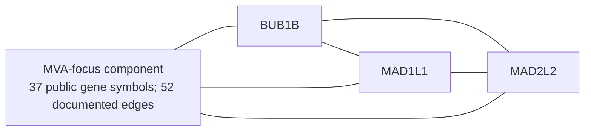

# **An Integrated Approach to Phenotype Assessment, Variant Prioritization, and Drug Repurposing in Suspected Mosaic Variegated Aneuploidy** 
**Team:** mvagama  
**Authors:** [Assyfa Atha](https://huggingface.co/Assyfa)¹ (Pharmacy); [Kayla Queenazima](https://huggingface.co/kaylazima)¹ (Biomedical Engineering); [Nayaka Bagus](https://huggingface.co/nayakabgs)¹ (Medicine); [Farrel Alfaza Marsetyo](https://huggingface.co/farrelmarsetyo)¹ (Medicine); [Nauval Rajwaa Raysendria](https://huggingface.co/NauvalRR)¹ (Biology); [Wafiq Hanifah](https://huggingface.co/wafiqhanifah)¹; [I Made Rhamandana Putra](https://huggingface.co/rhamandanaputra)¹ (Pharmacy).  
**Affiliation:** ¹ University Gadjah Mada, Indonesia

## **Executive Summary**

This research-only study integrates phenotype-based assessment, whole-genome sequencing (WGS) triage, network context, pathway analyses, and literature-based drug repurposing for a suspected case of mosaic variegated aneuploidy (MVA). The phenotype-led review prioritised spindle assembly/mitotic checkpoint (P1), chromosome segregation (P2), and sodium-coupled phosphate transport (P7) as hypotheses for downstream investigation. The dry-lab pipeline retained 2,215 of 18,252 annotated records and yielded 1,985 candidate seed genes. STRING returned 477 high-confidence associations; its MVA-focus component contained 37 genes and 52 edges. The separate Phase 2 Reactome/g:Profiler export returned 84 pathway rows, of which 34 had FDR ≤0.05; the independent P0–P7 g:Profiler analysis returned 16,455 rows with no BH q ≤0.05, and the native DAVID addendum found 2 of 318 chart terms at Benjamini ≤0.05. These are annotation and network results, not evidence of pathway activation, causal variants, diagnosis, or treatment response. BUB1B remains the leading P1/P2 candidate hypothesis; SLC34A1 remains conditional for P7. Variant pathogenicity, phase, and segregation remain unresolved, and no patient-specific treatment recommendation follows.

### **Method Abstract**

This study used a staged, research-only workflow to connect a suspected MVA phenotype with WGS-derived candidate hypotheses and public biological evidence. Upstream variant processing used GRCh38, quality filtering, normalisation, VEP and snpEff consequence annotation, and population, clinical, and computational annotations. Phase 0 applied transparent coordinate, rarity, and impact gates to 18,252 annotated records, retaining 2,215 research candidates and 1,985 genes with at least one passing candidate. These genes were mapped to official symbols and queried against STRING v12.5 at combined score ≥0.700 without network expansion, yielding 477 associations. A 37-gene, 52-edge MVA-focus component provided descriptive context around documented checkpoint anchors; it did not establish causality. Pathway findings were kept provider-specific: the Phase 2 Reactome/g:Profiler export contained 84 rows, 34 with FDR ≤0.05; an independent custom-background g:Profiler analysis returned 16,455 rows with no BH-adjusted q ≤0.05 (lowest q 0.08036975); and a human-operated DAVID addendum returned 318 chart terms, 2 with Benjamini ≤0.05. Literature mapping and manual PubMed review supplied contextual, not diagnostic, support for P1/P2 and a conditional P7 hypothesis. Strengths include explicit gates, provenance, public evidence sources, and separation of statistical analyses. Limits include unresolved allele phase and segregation, gene-identifier mapping loss, incomplete literature screening and risk-of-bias appraisal, pathway annotations that do not measure activity, and network associations that do not prove mechanism or drug response. The results prioritise hypotheses for validation and do not establish an MVA diagnosis, causal genotype, or treatment.

## **Variant Characterization and Mechanism**

Whole-genome sequencing identified two heterozygous variants in *BUB1B* (15q15.1; NM\_001211.6), encoding the 1,050-residue kinetochore protein BUBR1. c.2210T\>G, p.(Leu737Ter) (chr15:40,209,701T\>G, GRCh38; [rs759242053](https://www.ncbi.nlm.nih.gov/clinvar/RCV000641226/)) is classified as pathogenic for MVA1 in ClinVar (Variation ID 533901); the premature termination codon lies well upstream of the final exon and is positionally equivalent to the reported truncating alleles 731X and 753X, for which neither protein nor transcript is detectable in patient cells, consistent with nonsense-mediated decay (Suijkerbuijk et al., 2010). c.3006T\>G, p.(Asn1002Lys) (chr15:40,220,612T\>G) is absent from ClinVar, dbSNP and the literature and lies within the C-terminal pseudokinase domain (UniProt O60566, residues 766–1,050). Because human BUBR1 has no demonstrable catalytic activity, its conserved triad residues serving conformational rather than catalytic roles (Suijkerbuijk et al., 2012), substitutions in this domain act by destabilising the protein; I909T and R727C reduce steady-state BUBR1 five- to tenfold in an HSP90-dependent manner. Six MVA1 missense alleles are annotated in BUBR1 (R550Q, R814H, L844F, I909T, Q921H, L1012P), each reported *in trans* with a truncating allele, and L1012P lies ten residues from the present substitution. Hypomorphic loss of function through protein destabilisation, rather than gain of function or a dominant-negative effect, is therefore the expected mechanism. The two variants lie 10,911 bp apart and were not co-phased, so the *trans* configuration remains inferred rather than demonstrated.

BUBR1 is a structural component of the spindle assembly checkpoint. Recruited to unattached kinetochores through its BUB3-binding GLEBS motif, it assembles the mitotic checkpoint complex with MAD2, BUB3 and CDC20, sequestering CDC20 and preventing the anaphase-promoting complex/cyclosome (APC/C) from ubiquitinating securin and cyclin B1 until attachment is complete; through its KARD domain it recruits PP2A-B56 to oppose Aurora B and permit error correction. Reduction of total BUBR1 compromises both functions, and patient-derived cells carrying these allele combinations fail to arrest in mitosis following nocodazole or STLC treatment, a defect rescued by re-expression of wild-type BUBR1. A construct truncated at residue 731 nonetheless supported both checkpoint signalling and chromosome alignment in reconstitution assays, indicating that truncation position alone does not predict dysfunction; the operative defect in patients is the two- to sixfold reduction in full-length protein. Complete loss is not survivable — in the murine allelic series X753/L1002P is lethal before E13.5 and hypomorph/truncation dies within 18 h of birth, whereas hypomorph/L1002P survives with growth retardation and a median lifespan of 343 days against 691 days in wild type — so viable patients carry one null allele alongside one retaining partial function, as in the reported genotypes 386X/R727C, 753X/R814H, 731X/Y155C and null/I909T. The present genotype conforms to this pattern.

A sub-threshold checkpoint permits APC/C activation before attachment is complete, producing premature chromatid separation and recurrent whole-chromosome missegregation, and hence the constitutional mosaic aneuploidy that defines the disorder. Aneuploid cells sustain proteotoxic and replication stress, activate p53 and accumulate *CDKN2A*\-driven senescence with an associated secretory phenotype; in BubR1-insufficient mice this presents as growth retardation, cataracts, lipodystrophy, sarcopenia and kyphosis, while recurrent missegregation independently elevates tumour risk. Both arms are represented in the human phenotype: intrauterine and postnatal growth failure, microcephaly, developmental delay, cataracts and other ocular anomalies, seizures, renal anomalies including nephrocalcinosis, and a high childhood incidence of rhabdomyosarcoma and Wilms tumour, with gastrointestinal malignancy reported in adults carrying particular alleles. Residual protein level rather than variant class determines severity, with approximately 40–90% reduction associating with tumour predisposition and mild ageing and greater than 90% with progeroid features or perinatal lethality; hyperactive mTORC1 signalling in muscle has been proposed as a driver of sarcopenia in this context and represents the only node in the pathway currently addressed by a licensed drug class.

### **PHASE 0: VCF Processing & Variant Filtering**

The upstream GRCh38 WGS workflow split multiallelic sites and left-aligned indels with bcftools, retained `FILTER=PASS` calls with DP ≥10 and GQ ≥20, and annotated consequences using VEP with snpEff as an orthogonal annotation. gnomAD, ClinVar, and computational predictor evidence were consolidated before Phase 0 applied the current gate: valid coordinates; rarity defined as AF ≤0.001 or gnomAD `not_found`, with unknown AF admitted only for an MVA-context gene; and at least one impact criterion (high-impact/PVS1-type consequence, ClinVar P/LP, or qualifying CADD, SpliceAI, REVEL, or AlphaMissense evidence). `NHOMALT` is recorded as a population-homozygote flag rather than used as a current gate. This reduced 18,252 annotated records to 2,215 research candidates and 1,985 Phase 1 seed genes; 168 genes had multiple qualifying hits, but allele phase remains unresolved. These seed genes are triage outputs, not verified causal genes.

## **Drug Repurposing Strategy**

### **PHASE 1: Phenotype-Based Assessment of MVA Subtypes**

**1.1 Literature Search Strategy**  
The patient's clinical phenotype was evaluated to identify the most likely subtype of mosaic variegated aneuploidy (MVA). A targeted literature search was conducted using PubMed to identify case reports and case series describing MVA associated with BUB1B, CEP57, and TRIP13, which are established MVA-associated genes. Three gene-specific search strategies were used:

| Component | Query 1: BUB1B | Query 2: CEP57 | Query 3: TRIP13 |
| ----- | ----- | ----- | ----- |
| Target gene | BUB1B | CEP57 | TRIP13 |
| Gene-specific search term | BUB1B\[Title/Abstract\] | CEP57\[Title/Abstract\] | TRIP13\[Title/Abstract\] |
| MVA-related terms | ("mosaic variegated aneuploidy"\[Title/Abstract\] OR "mosaic aneuploidy"\[Title/Abstract\]) | ("mosaic variegated aneuploidy"\[Title/Abstract\] OR "mosaic aneuploidy"\[Title/Abstract\]) | ("mosaic variegated aneuploidy"\[Title/Abstract\] OR "mosaic aneuploidy"\[Title/Abstract\] OR "constitutional aneuploidy"\[Title/Abstract\]) |
| Study design terms | ("Case Reports"\[Publication Type\] OR "case report"\[Title/Abstract\] OR "case series"\[Title/Abstract\]) | ("Case Reports"\[Publication Type\] OR "case report"\[Title/Abstract\] OR "case series"\[Title/Abstract\]) | Not specified |
| Search strategy | Gene term AND MVA-related terms AND study design terms | Gene term AND MVA-related terms AND study design terms | Gene term AND MVA-related terms |
| Records retrieved | 17 | 10 | 6 |
| Records retained after English-language and full-text availability screening | 13 | 8 | 5 |
| Records excluded after abstract screening for lack of relevance | 9 | 7 | 1 |

**1.2 Results and Phenotypic Interpretation**  
The retrieved literature was reviewed to compare the patient's clinical manifestations with those reported in individuals with MVA associated with BUB1B, CEP57, and TRIP13. Based on the phenotype-focused assessment, the patient's clinical presentation was considered more consistent with MVA type 1, which is associated with BUB1B-related dysfunction. The phenotype-based assessment was used to prioritize MVA subtype hypotheses for subsequent genetic analysis. The findings were not considered sufficient to establish a definitive molecular diagnosis in the absence of confirmatory genetic and cytogenetic evidence. The literature search records and phenotype comparison are available in **[The MVA Hackathon 2026 workbook](https://github.com/kaylaque/mva-hackathon/blob/main/docs/The%20MVA%20Hackathon%202026.xlsx)**.

### **PHASE 2: Phenotype-Focused Literature Review and Pathway Prioritization** 

**2.1. Phenotype–Pathway Mapping**  
Following the phenotype-based assessment in Phase 1, a literature review was conducted to investigate the association between the patient's eight clinical phenotypes and eight prioritized biological pathways (P1–P8). The pathways were evaluated according to the total number of mapped articles, the distribution of articles across individual phenotypes, and the number of pathways associated with at least one phenotype. The eight phenotypes were defined using the corresponding Human Phenotype Ontology (HPO) terms, as summarized in Table 1\.

**Table 1\. Clinical phenotypes included in the literature-based pathway analysis**

| ID | HPO term | Clinical phenotype |
| ----- | ----- | ----- |
| HP1 | HP:0002859 | Rhabdomyosarcoma |
| HP2 | HP:0000121 | Nephrocalcinosis |
| HP3 | HP:0004322 | Short stature |
| HP4 | HP:0001508 | Failure to thrive |
| HP5 | HP:0003202 | Skeletal muscle atrophy |
| HP6 | HP:0001622 | Premature birth |
| HP7 | HP:0001518 | Small for gestational age |
| HP8 | HP:0200067 | Recurrent spontaneous abortion |

*Note: HP8 represents a parental reproductive history rather than a direct phenotype of the proband.*

**2.2. Literature Review Results for P1–P8**  
The phenotype-focused literature mapping yielded different levels of evidence across the eight pathways. Table 2 summarizes the total number of mapped articles, phenotype-specific article counts, and the number of articles associated with at least one of the eight phenotypes.

**Table 2\. Distribution of literature-mapped articles across pathways and clinical phenotypes**

| Pathway | Biological process | Total articles | HP1 | HP2 | HP3 | HP4 | HP5 | HP6 | HP7 | HP8 | Any HP |
| ----- | ----- | ----- | ----- | ----- | ----- | ----- | ----- | ----- | ----- | ----- | ----- |
| P1 | Spindle assembly / mitotic checkpoint | 58 | 5 | 0 | 7 | 1 | 1 | 0 | 1 | 5 | 15 |
| P2 | Chromosome segregation | 34 | 3 | 0 | 6 | 0 | 1 | 0 | 1 | 6 | 13 |
| P3 | Cell cycle | 26 | 3 | 0 | 3 | 0 | 0 | 0 | 0 | 3 | 8 |
| P4 | Cellular senescence | 24 | 0 | 0 | 0 | 0 | 0 | 0 | 0 | 0 | 0 |
| P5 | Apoptosis | 16 | 1 | 0 | 4 | 0 | 0 | 0 | 1 | 2 | 6 |
| P6 | APC/C-mediated cell-cycle protein degradation | 12 | 2 | 0 | 2 | 0 | 0 | 0 | 1 | 2 | 5 |
| P7 | Sodium-coupled phosphate transport | 12 | 0 | 8 | 6 | 4 | 0 | 0 | 0 | 0 | 11 |
| P8 | p53 signaling / regulation | 10 | 1 | 0 | 0 | 0 | 0 | 0 | 0 | 0 | 1 |

*HP1–HP8 correspond to the phenotypes defined in Table 1\. “Any HP” represents the number of mapped articles associated with at least one of the eight phenotypes. Counts are reproduced from the supplied phenotype-focused literature mapping.*

**2.3 Comparative Interpretation of P1–P8**  
The literature mapping identified three pathways with the strongest relevance to the phenotype set.  
**P1: Spindle assembly/mitotic checkpoint:** This pathway had the largest total number of mapped articles (58) and 15 articles associated with at least one phenotype. The highest phenotype-specific counts were observed for short stature (HP3; 7 articles), rhabdomyosarcoma (HP1; 5 articles), and parental recurrent spontaneous abortion (HP8; 5 articles).  
**P2: Chromosome segregation:** This pathway had 34 mapped articles, including 13 associated with at least one phenotype. Its main phenotype associations were short stature (HP3; 6 articles), parental recurrent spontaneous abortion (HP8; 6 articles), and rhabdomyosarcoma (HP1; 3 articles).  
**P7: Sodium-coupled phosphate transport:** Although this pathway had fewer total articles (12), 11 were associated with at least one phenotype. It showed the most phenotype-specific relevance to nephrocalcinosis (HP2; 8 articles), short stature (HP3; 6 articles), and failure to thrive (HP4; 4 articles). P3 (cell cycle) and P5 (apoptosis) also showed associations with some phenotypes. However, P3 had fewer phenotype-associated articles than P1 and P2, while P5 had six articles associated with at least one phenotype. P4 had no mapped articles associated with the eight phenotypes in this table, and P8 had only one. These counts support the prioritization of P1, P2, and P7 for subsequent analysis. P1 and P2 represent complementary mechanisms involving mitotic checkpoint regulation and chromosome segregation, whereas P7 represents a distinct pathway relevant to renal phosphate handling and growth-related manifestations. Importantly, article counts indicate the extent of mapped literature rather than the strength of causal evidence. The selection of pathways therefore serves as a hypothesis-generation strategy and does not establish that these pathways explain the patient's complete phenotype.

**2.4 Selection of Pathways for WGS Integration**  
**Table 3\. Rationale for selecting P1, P2, and P7 for downstream analysis**

| Selected pathway | Evidence from literature mapping | Rationale for selection | Next analytical step |
| ----- | ----- | ----- | ----- |
| P1 — Spindle assembly / mitotic checkpoint | 58 total articles; 15 associated with ≥1 phenotype | Broad literature coverage and relevance to rhabdomyosarcoma, short stature, and parental recurrent pregnancy loss | Identify pathway-associated genes and intersect them with WGS findings |
| P2 — Chromosome segregation | 34 total articles; 13 associated with ≥1 phenotype | Mechanistically complementary to P1, with associations involving rhabdomyosarcoma, short stature, and parental recurrent pregnancy loss | Identify chromosome-segregation genes and assess WGS variants |
| P7 — Sodium-coupled phosphate transport | 12 total articles; 11 associated with ≥1 phenotype | Phenotype-specific relevance to nephrocalcinosis, short stature, and failure to thrive | Evaluate phosphate-transport and related renal mineral-handling genes in WGS results |

**2.5 Conclusion**  
The phenotype-focused literature review prioritized P1 (spindle assembly/mitotic checkpoint), P2 (chromosome segregation), and P7 (sodium-coupled phosphate transport) for downstream genetic investigation. P1 and P2 were selected based on their broader literature coverage and complementary roles in chromosome regulation, whereas P7 was selected because of its more specific association with nephrocalcinosis and growth-related phenotypes. These pathways were subsequently used to guide the selection of pathway-associated genes for comparison with the WGS results and ShinyGO enrichment findings in Phase 3\.

### **PHASE 3: Integration of Pathway-Associated Genes, WGS Findings, and ShinyGO Enrichment**

**3.1 Pathway-Directed Gene Prioritization**  
Following the selection of P1, P2, and P7 in Phase 2, genes involved in these pathways were identified and compared with the annotated variants in Results\_MVA.xlsx. Candidate genes were evaluated according to pathway relevance, phenotype compatibility, variant consequence, pipeline-reported pathogenicity classification, clinical significance annotations, and available inheritance information. ShinyGO enrichment results were then examined to determine whether the WGS-derived gene set showed enrichment in biological pathways relevant to the selected hypotheses. The analysis distinguished direct gene overlap from statistical pathway enrichment and did not interpret enriched pathway labels as clinical diagnoses.

**3.2 Integration of WGS Findings with P1 and P2**  
**Table 4\. Prioritized candidate genes associated with P1 and P2**

| Gene | Pathway association | WGS findings | ShinyGO evidence | Integrated interpretation |
| ----- | ----- | ----- | ----- | ----- |
| BUB1B | P1 and P2 | p.Leu737\* (stop-gained; pipeline-labeled Pathogenic) and p.Asn1002Lys (missense; pipeline-labeled Likely Pathogenic) | Present in the KEGG human T-cell leukemia virus 1 infection gene set | Leading candidate requiring variant validation, phase determination, and segregation analysis |
| MAD1L1 | Mitotic checkpoint / chromosome segregation | p.Arg59Cys has conflicting clinical significance annotations | Present in the same KEGG gene set as BUB1B | Secondary candidate; clinical annotation requires resolution |
| TTK | Mitotic checkpoint-related processes | p.Ala97Val labeled VUS; p.Asp52Glu labeled benign | No specific overlap in highlighted enrichment results | Exploratory candidate with limited current support |
| CENPE | P2 — Chromosome segregation | Listed variants labeled benign, with relatively high population allele frequencies | No highlighted overlap in inspected enrichment results | Not prioritized as a causal candidate based on current variants |

BUB1B was prioritized because it connects the literature-supported mitotic checkpoint and chromosome segregation hypotheses with two potentially relevant variants in the WGS results. Given the autosomal recessive inheritance associated with BUB1B-related MVA type 1, it is essential to determine whether the two variants are pathogenic and located on opposite alleles (in trans). The current literature review does not independently establish these conditions.  
The presence of BUB1B and MAD1L1 in the same enriched KEGG gene set provides contextual overlap with mitotic checkpoint biology, but it does not independently validate P1 or P2.

**3.3 Integration of WGS Findings with P7**  
**Table 5\. Candidate genes associated with sodium-coupled phosphate transport**

| Gene | Pathway association | WGS findings | ShinyGO evidence | Integrated interpretation |
| ----- | ----- | ----- | ----- | ----- |
| SLC34A1 | P7 — Sodium-coupled phosphate transport | p.Ala133Val; pipeline label conflicts with clinical significance annotations; recorded as Single\_Hit | No direct enrichment supporting P7 in inspected results | Phenotype-driven secondary candidate; variant causality remains unresolved |
| SLC34A3 | Related renal phosphate transport | p.Glu513Val labeled benign | No direct enrichment supporting P7 in inspected results | The reported variant does not provide strong support for causality |

SLC34A1 was retained because its biological role is relevant to phosphate homeostasis and the nephrocalcinosis phenotype. However, the p.Ala133Val variant cannot currently be considered a confirmed causal variant because its clinical annotations are conflicting and the available results do not establish a second pathogenic allele. The pathway hypothesis is therefore retained independently of the final classification of this specific variant.

**3.4 Protein-Protein Interaction Enrichment Results**  
The 1,985 Phase 1 seed genes were mapped to official symbols and queried in STRING v12.5 at a combined score threshold of ≥0.700, with `additional_nodes=0` to avoid network expansion. STRING returned 477 associations across 1,600 connected components. The MVA-focus component contained 37 genes and 52 edges and was anchored by BUB1B, MAD1L1, and MAD2L2. It provides descriptive network context consistent with the P1/P2 checkpoint and chromosome-segregation hypotheses; it does not directly support P7, establish a causal variant, or identify a drug target.

*Figure 1. Conceptual schematic of the documented MVA-focus STRING component; it is not an exact rendered subgraph and does not depict all genes or edges.*

**3.5 ShinyGO Enrichment Results**  
**Table 6\. Selected ShinyGO enrichment results**

| Enriched pathway | FDR | Fold enrichment | Principal interpretation |
| ----- | ----- | ----- | ----- |
| Allograft rejection | 2.19 × 10⁻⁷ | 18.45 | Strong enrichment dominated by HLA-associated genes |
| Type I diabetes mellitus | 2.86 × 10⁻⁷ | 16.35 | Substantial overlap with antigen-presentation genes |
| Graft-versus-host disease | 2.86 × 10⁻⁷ | 15.99 | Largely driven by the same HLA-associated genes |
| Antigen processing and presentation | 3.38 × 10⁻⁶ | 9.75 | Immune-related enrichment involving HLA genes and HSPA6 |
| Human T-cell leukemia virus 1 infection | 1.46 × 10⁻⁴ | 4.64 | Includes BUB1B and MAD1L1 among a broader set of genes |

The strongest ShinyGO enrichment signals were predominantly immune-related and driven by HLA-associated genes. The KEGG human T-cell leukemia virus 1 infection term included BUB1B and MAD1L1, providing limited contextual support for the presence of mitotic checkpoint-related genes in the submitted gene set. Nevertheless, this result does not demonstrate a specific enrichment of P1 or P2, nor does it indicate HTLV-1 infection. No direct enrichment supporting P7 was established in the inspected results. This absence does not exclude the phosphate-transport hypothesis, which was prioritized primarily from phenotype-focused literature mapping.

**3.6 Pathway Enrichment Results**  
Three analyses were interpreted separately. The Phase 2 Reactome/g:Profiler export returned 84 pathway rows, of which 34 met FDR ≤0.05; the lowest-FDR results were broad annotation terms and were not treated as confirmation of P1, P2, or P7. The independent P0–P7 g:Profiler analysis compared candidate foreground genes with all 8,876 evaluated genes as its custom background: 16,455 rows were returned, none had BH q ≤0.05, and the lowest q was 0.08036975. The native, human-operated DAVID addendum submitted 1,926 identifiers and mapped 1,591 foreground genes; its custom background mapped 8,740 submitted identifiers to 8,371 genes. DAVID returned 318 chart terms, with 2 at Benjamini ≤0.05; the checked-in documentation does not record their names. The 74 shared stable identifiers between DAVID and g:Profiler describe annotation coverage overlap, not replication of statistically significant pathways. Together, these analyses provide literature-compatible pathway context but do not validate P1, P2, or P7, measure pathway activity, or support causal or pharmacological inference.

**3.7 Integrated Prioritization**  
The literature review supplies the primary rationale for P1/P2 and the conditional P7 hypothesis. Candidate WGS evidence places BUB1B at the intersection of P1 and P2, while unresolved pathogenicity, allele phase, and segregation prevent causal classification. STRING contextualises BUB1B within a documented high-confidence component but cannot establish mechanism or therapeutic direction. ShinyGO and the separate pathway analyses did not independently confirm P1, P2, or P7; their results therefore do not change the existing primary, secondary, and exploratory ranking. Medication hypotheses remain distinct from gene evidence and require disease-specific confirmation.
**Table 7\. Final gene–pathway prioritization**

| Priority | Candidate gene | Pathway | Main supporting evidence | Key limitation |
| ----- | ----- | ----- | ----- | ----- |
| Primary | BUB1B | P1 and P2 | Literature-compatible MVA mechanism, two candidate WGS findings, and descriptive STRING component context | Pathogenicity, phase, segregation, and functional effect remain unresolved; enrichment does not validate P1/P2 |
| Secondary | SLC34A1 | P7 | Phenotype-led relevance to phosphate homeostasis and nephrocalcinosis | Conflicting annotation, no demonstrated second pathogenic allele, and no independent enrichment confirmation |
| Exploratory | MAD1L1, TTK, CENPE | P1/P2-related | Biological pathway relevance and available WGS annotations | Network and pathway context are non-causal; variant evidence is conflicting, uncertain, or benign |

**3.8. Conclusion**  
The integrated analysis retains BUB1B as the leading P1/P2 candidate hypothesis and SLC34A1 as a conditional P7 candidate. Literature mapping, candidate WGS evidence, and descriptive network context align most closely for P1/P2, but neither STRING nor pathway enrichment resolves pathogenicity, phase, segregation, or functional effect. P7 has no independent enrichment confirmation. These findings are hypothesis-generating and provide no definitive molecular diagnosis or treatment recommendation.

### **PHASE 4: Integrated Advanced Search for Drug Repurposing**

**4.1 Literature search strategy**  
A targeted literature search will be conducted to identify potential drug-repurposing candidates based on the integration of three sources of evidence: (1) phenotype-associated pathways identified in Phase 2, particularly P1 (spindle assembly/mitotic checkpoint), P2 (chromosome segregation), and P7 (sodium-coupled phosphate transport); (2) candidate genes identified through whole-genome sequencing (WGS); and (3) pathways identified through ShinyGO enrichment analysis. The search will focus on studies investigating therapeutic targets, drug candidates, pharmacological modulators, and existing interventions relevant to these pathways and genes. Evidence from human studies, disease-specific case reports, preclinical models, and mechanistic studies will be considered. The search will be conducted using PubMed, with additional searches in other scientific databases if necessary. Search results will be screened based on their relevance to the identified genes, pathways, disease mechanisms, and potential for drug repurposing. Particular attention will be given to the proposed mechanism of action, direction of pharmacological effects, level of evidence, and potential risks associated with modifying the target pathway. Because the WGS findings are preliminary and some variants have uncertain or conflicting classifications, the search will explore potential therapeutic strategies rather than assume that any candidate drug is appropriate for the patient.

| No. | Pathway | Search Query |
| ----- | ----- | ----- |
| 1 | P1: Spindle Assembly and Mitotic Checkpoint | ("BUB1B" OR "BUBR1" OR "MAD1L1" OR "TTK" OR "MPS1") AND ("mitotic checkpoint" OR "spindle assembly checkpoint" OR "mitotic checkpoint complex") AND ("drug repurposing" OR therapeutic OR treatment OR drug OR compound OR inhibitor OR activator) |
| 2 | P2: Chromosome Segregation | ("BUB1B" OR "MAD1L1" OR "TTK" OR "CENPE") AND ("chromosome segregation" OR "chromosome missegregation" OR "chromosomal instability" OR "aneuploidy") AND ("drug repurposing" OR therapeutic OR treatment OR drug OR compound OR inhibitor OR activator) |
| 3 | P7: Sodium-Coupled Phosphate Transport | ("SLC34A1" OR "SLC34A3" OR "NaPi-IIa" OR "NaPi-IIc") AND ("drug repurposing" OR treatment OR therapy OR therapeutic OR "phosphate supplementation" OR "phosphate metabolism") AND ("nephrocalcinosis" OR "renal phosphate wasting" OR "hypercalciuria" OR "short stature" OR "growth failure") |

**4.2 Results of the Advanced Literature Search**  
**4.2.1 Overview of the Evidence**  
The three PubMed exports yielded evidence with different degrees of clinical relevance.

| Pathway | Main findings | Implications for drug repurposing |
| ----- | ----- | ----- |
| P1 — Spindle assembly and mitotic checkpoint | BUB1B is directly associated with MVA1. Additional studies investigate checkpoint regulation and inhibition in cancer models. | No established treatment was identified that restores BUB1B function or corrects the underlying checkpoint defect in MVA. |
| P2 — Chromosome segregation | TTK/MPS1 inhibitors and CENP-E-related studies demonstrate that disrupting mitotic regulation can induce chromosome missegregation and genomic instability. | These compounds are primarily investigated as anticancer agents and should not be interpreted as corrective therapies for a constitutional chromosome-instability disorder. |
| P7 — Sodium-coupled phosphate transport | Clinical reports and reviews describe SLC34A1- and SLC34A3-related disorders, including nephrocalcinosis, hypercalciuria, phosphate wasting, and impaired growth. | Oral phosphate supplementation is a potential disease-specific intervention if an SLC34A1-related phosphate-handling disorder is independently confirmed. |

The findings indicate that P1 and P2 are supported mainly by mechanistic and cancer-related studies for therapeutic purposes, whereas P7 includes more directly relevant clinical evidence for a specific subset of renal and growth-related manifestations.

**4.2.2 Query 1 — P1: Spindle Assembly and Mitotic Checkpoint**  
BUB1B encodes BUBR1, a key component of the spindle assembly checkpoint (SAC), which contributes to accurate chromosome segregation during cell division. The search identified a disease-relevant report by Pathogenic correlation between mosaic variegated aneuploidy 1 (MVA1) and a novel BUB1B variant: a reappraisal of a severe syndrome (2022). The report described a child with MVA1 carrying a novel BUB1B variant and reviewed previously reported MVA1 cases. This provides direct clinical support for the relationship between BUB1B dysfunction and MVA, but it does not establish a pharmacological treatment for the syndrome. Other records investigated BUB1B in cancer biology. For example, Spindle assembly checkpoint gene BUB1B is essential in breast cancer cell survival (2021) found that reducing BUB1B expression decreased cancer-cell viability and increased apoptosis. Such findings demonstrate that BUB1B-dependent checkpoint regulation is pharmacologically or experimentally relevant in cancer. However, reducing BUB1B activity in cancer cells is mechanistically different from restoring normal BUBR1 function in an individual with a suspected inherited defect. The updated search also included studies investigating TTK/MPS1 and polo-like kinase 1 (PLK1) inhibitors. These compounds can alter checkpoint activity and induce mitotic arrest or mitotic catastrophe in cancer models. Their purpose is to exploit vulnerabilities in proliferating malignant cells, rather than correct inherited defects in chromosome segregation. Interpretation for MVA: The literature supports BUB1B as a biologically relevant candidate for the P1 hypothesis. However, no established drug capable of restoring the function of a disease-associated BUB1B variant or correcting MVA-associated chromosomal instability was identified in the retrieved evidence. Cancer-directed checkpoint inhibitors should therefore not be prioritized as corrective treatments for MVA.

**4.2.3 Query 2 — P2: Chromosome Segregation**  
The second search investigated chromosome segregation and chromosomal instability in relation to BUB1B, MAD1L1, TTK, and CENPE. Several studies examined TTK/MPS1 inhibitors as anticancer agents. TTK Inhibitors as a Targeted Therapy for CTNNB1 (β-catenin) Mutant Cancers (2017) reported that CTNNB1-mutant cancer cell lines were more sensitive to TTK inhibition and that the inhibitor NTRC 0066-0 inhibited tumor growth in a xenograft model. These findings support the investigation of TTK inhibition in selected cancer contexts, but they do not demonstrate benefit in MVA. Other retrieved studies examined chromosome alignment and segregation following CENP-E disruption. A study published in Cell Proliferation in 2025 reported that CENP-E deletion caused chromosome alignment and segregation defects, spindle disorganization, and genomic instability. This supports the functional importance of CENP-E in maintaining chromosome stability but does not establish a therapeutic strategy for patients with inherited chromosome-segregation defects. Taken together, these studies indicate that interfering with checkpoint kinases or chromosome-alignment machinery can increase mitotic errors. This is a potentially useful strategy for killing cancer cells, but it does not follow that the same interventions would benefit an individual with suspected MVA. Interpretation for MVA: TTK/MPS1 inhibitors and other compounds that deliberately disrupt chromosome segregation should not be selected as corrective drug-repurposing candidates for P2. Their experimental anticancer effects do not establish safety or efficacy in MVA, and further disruption of mitotic control could plausibly aggravate the underlying biological problem.

**4.2.4 Query 3 — P7: Sodium-Coupled Phosphate Transport**  
The third search focused on SLC34A1 and SLC34A3, which encode sodium-dependent phosphate transporters involved in renal phosphate handling. The retrieved literature describes SLC34A1-related disorders associated with renal phosphate-handling abnormalities, including infantile hypercalcemia, hypercalciuria, nephrocalcinosis, and impaired growth. SLC34A3-related disease, particularly hereditary hypophosphatemic rickets with hypercalciuria (HHRH), is also associated with renal phosphate wasting and skeletal manifestations. These disorders have overlapping clinical features but are not interchangeable; treatment must be guided by the specific diagnosis and biochemical abnormalities. A particularly relevant study was Turan et al. (2026), Targeting Hypercalciuria in SLC34A1-Related Disorders: Impact of Oral Phosphate Therapy and Novel Genetic Insights in Pediatric Case Series. This retrospective case series included 11 patients from unrelated families carrying pathogenic or likely pathogenic SLC34A1 variants. All patients had hypercalciuria and nephrocalcinosis at diagnosis. Oral phosphate supplementation, reported at 5–20 mg/kg/day, was associated with normalization of urinary calcium excretion in 10 of 11 patients and improved linear growth in all but one. These results provide human clinical evidence supporting oral phosphate supplementation in confirmed SLC34A1-related disorders. Nevertheless, the evidence comes from a small retrospective series rather than a randomized controlled trial, and the reported results cannot automatically be generalized to individuals without a confirmed SLC34A1-related disorder. The search also retrieved the 2026 French national diagnosis and care protocol for infantile idiopathic hypercalcemia. The protocol discusses management according to disease presentation, severity, and underlying genetic mechanism, including measures such as modifying calcium and vitamin D intake, hydration, and selected pharmacological interventions. This reinforces the importance of determining the specific cause of the renal phenotype before selecting treatment. Additional reports concerning HHRH describe phosphate supplementation and, in selected cases, other interventions intended to improve growth or biochemical abnormalities. However, some evidence is derived from individual case reports involving multiple simultaneous interventions, making the contribution of each treatment difficult to establish. Interpretation for MVA: Oral phosphate supplementation is the strongest clinically grounded candidate identified in the P7 search for a confirmed SLC34A1-related phosphate-handling disorder. However, the patient's SLC34A1 p.Ala133Val variant has conflicting clinical-significance annotations, and the available WGS findings do not establish a second disease-causing allele. The SLC34A3 p.Glu513Val variant is annotated as benign. Consequently, the P7 findings support further diagnostic evaluation rather than an assumption that the patient has an SLC34A1-related disorder.

**4.3 Drug-Repurposing Candidate Assessment**

| Candidate or intervention | Supporting evidence | Evidence level and limitation | Final assessment |
| ----- | ----- | ----- | ----- |
| Oral phosphate supplementation | Improved urinary calcium excretion and growth in a small SLC34A1-related pediatric case series | Human observational evidence in a specific confirmed disease; applicability depends on biochemical and genetic confirmation | **Conditional lead candidate for P7** |
| TTK/MPS1 inhibitors | Preclinical anticancer studies demonstrate disruption of checkpoint signaling and inhibition of selected tumors | Predominantly cancer-focused; no evidence that these drugs correct MVA | **Not prioritized as corrective MVA therapy** |
| PLK1 inhibitors | Cancer studies report altered checkpoint activity, mitotic arrest, and tumor-cell death | Preclinical or disease-specific oncology evidence; does not establish benefit in MVA | **Not prioritized for MVA** |
| Rifampin or other interventions for selected hypercalcemic disorders | Evidence from specific metabolic disorders and limited clinical reports | Disease-specific and not directly transferable to the unresolved P7 hypothesis | **Not selected as a general MVA candidate** |
| Growth hormone and other adjunctive interventions in HHRH | Reports of improved growth in selected cases receiving multiple interventions | Limited case-level evidence; treatment effects may be confounded by other interventions and developmental factors | **Not selected as a primary repurposing candidate** |

The assessment prioritizes mechanistic compatibility and clinical relevance rather than the number of studies reporting a drug effect. A treatment investigated in cancer cells is not automatically suitable for a constitutional genetic disorder, and a treatment used for one phosphate-handling disorder is not automatically applicable to another.

**4.4 Integrated Discussion**  
The updated PubMed evidence supports different conclusions for the three selected pathways.  
First, P1 and P2 remain strongly relevant to the genetic hypothesis involving BUB1B. The clinical literature on MVA1 supports the relationship between BUB1B dysfunction and chromosome-segregation abnormalities. Nevertheless, the retrieved therapeutic literature largely concerns cancer models in which checkpoint activity is inhibited or disrupted to induce tumor-cell death. These findings do not identify a treatment that restores normal checkpoint function in MVA. Second, P7 offers the clearest disease-specific pharmacological lead, because clinical evidence supports oral phosphate supplementation in confirmed SLC34A1-related disorders. However, this conclusion is conditional. The current WGS evidence does not establish that the patient's SLC34A1 p.Ala133Val variant is causative, and no second pathogenic allele has been demonstrated. Further assessment of phosphate handling, calcium metabolism, renal function, and variant interpretation would be needed before considering this intervention clinically. Third, the eight HPO terms should not be treated as manifestations of one confirmed molecular mechanism. The pathway analysis is a hypothesis-generating framework. It does not establish that a single drug can simultaneously treat rhabdomyosarcoma, nephrocalcinosis, short stature, failure to thrive, skeletal muscle atrophy, premature birth, small for gestational age, and parental recurrent spontaneous abortion. In particular, the last phenotype represents parental reproductive history rather than a direct phenotype of the proband. If rhabdomyosarcoma is currently active, its assessment and management should follow an appropriate specialist oncology pathway. The presence of a suspected MVA-related disorder does not justify substituting experimental checkpoint inhibitors or phosphate-directed interventions for indicated oncological care.

**4.5 Limitations**  
Several limitations should be considered when interpreting these results:

1. Search and screening limitations. The three PubMed exports represent targeted searches rather than a fully documented systematic review. The total number of downloaded records should not be interpreted as the number of independent, eligible studies. Duplicate records, irrelevant records, preprints, and studies with limited clinical applicability require appropriate screening.  
2. Differences in evidence levels. The retrieved literature includes case reports, retrospective clinical studies, mechanistic investigations, and preclinical cancer experiments. These evidence types cannot be treated as equivalent.  
3. Unresolved genetic interpretation. The WGS findings include candidate variants whose pathogenicity and inheritance relationships require further validation. The BUB1B findings support a leading hypothesis but do not independently establish a definitive molecular diagnosis or confirm that the two variants are in trans.  
4. Unresolved P7 causality. The conflicting classification of SLC34A1 p.Ala133Val and the absence of a demonstrated second disease-causing allele limit the applicability of treatment evidence from confirmed SLC34A1-related disorders.  
5. Limited therapeutic generalizability. Evidence that a drug inhibits tumor growth or modifies a pathway in experimental models does not establish that it will restore physiological function, improve the patient's phenotype, or be safe in a rare genetic disorder.

## **Track 2 Submission Answers**

**Team identifier:** `mvagama`.

**Approach:** The study used hybrid automated and manual methods: transparent WGS filtering and public-database screening; manual PubMed review and pathway interpretation; and a human-operated DAVID enrichment addendum. Public sources used in implemented methods were VEP, gnomAD, ClinVar, PubMed/PMC, STRING, Reactome, g:Profiler, DAVID, Open Targets, ChEMBL, and DGIdb. Private hackathon WGS and clinical inputs were kept distinct from these public resources and were not submitted as drug-target knowledge. No proprietary drug-target database was identified in checked-in implemented methods; therefore no proprietary-source subsection is supplied.

**Mechanistic interpretation:** The leading model is a predicted BUB1B loss or hypomorphic effect affecting spindle-checkpoint function. The required trans configuration remains unproven, and the result is not a molecular diagnosis.

**AI disclosure:** The team reports using Claude Pro, ChatGPT Pro, and OpenCode Go. The team further reports that no case data were used for model training; this setting is team-reported and was not independently verified. Paid subscription tiers do not by themselves establish commercial API terms.

## **Conclusion**

The updated drug-repurposing search supports oral phosphate supplementation only as a conditional therapeutic hypothesis for a separately confirmed SLC34A1-related phosphate-handling disorder. For P1/P2, literature supports BUB1B and chromosome-segregation biology but does not establish an intervention that restores the underlying defect; TTK/MPS1 and PLK1 inhibitors are not prioritised as corrective MVA therapies. No single drug was identified for all eight phenotype terms. Further genetic, functional, and clinical validation is required before any patient-specific decision.

## **References**

1. Ensembl Variant Effect Predictor (VEP). https://www.ensembl.org/info/docs/tools/vep/index.html  
2. gnomAD. https://gnomad.broadinstitute.org/  
3. ClinVar. https://www.ncbi.nlm.nih.gov/clinvar/  
4. PubMed. https://pubmed.ncbi.nlm.nih.gov/; PubMed Central. https://pmc.ncbi.nlm.nih.gov/  
5. STRING database API and documentation. https://string-db.org/help/api/  
6. Reactome Analysis Service. https://reactome.org/dev/analysis  
7. g:Profiler API documentation. https://biit.cs.ut.ee/gprofiler/page/apis  
8. DAVID Functional Annotation Tool. https://davidbioinformatics.nih.gov/workspace.html  
9. Open Targets Platform documentation. https://platform-docs.opentargets.org/  
10. ChEMBL interface documentation. https://chembl.gitbook.io/chembl-interface-documentation  
11. DGIdb API. https://dgidb.org/api  
12. Suijkerbuijk SJE, et al. Molecular causes for BUBR1 dysfunction in mosaic variegated aneuploidy. *Cancer Research* (2010). https://doi.org/10.1158/0008-5472.CAN-09-4319  
13. Suijkerbuijk SJE, et al. The vertebrate mitotic checkpoint protein BUBR1 is an unusual pseudokinase. *Developmental Cell* (2012). https://doi.org/10.1016/j.devcel.2012.03.009  
14. Pathogenic correlation between mosaic variegated aneuploidy 1 (MVA1) and a novel BUB1B variant: a reappraisal of a severe syndrome. *Neurological Sciences* (2022). https://doi.org/10.1007/s10072-022-06247-w  
15. Spindle assembly checkpoint gene BUB1B is essential in breast cancer cell survival. *Breast Cancer Research and Treatment* (2021). https://doi.org/10.1007/s10549-020-05962-2  
16. TTK inhibitors as a targeted therapy for CTNNB1 (β-catenin) mutant cancers. *Molecular Cancer Therapeutics* (2017). https://doi.org/10.1158/1535-7163.MCT-17-0342  
17. Targeting hypercalciuria in SLC34A1-related disorders: impact of oral phosphate therapy and novel genetic insights in paediatric case series. *Calcified Tissue International* (2026). https://doi.org/10.1007/s00223-025-01462-x  
18. Project material: [The MVA Hackathon 2026 workbook](https://github.com/kaylaque/mva-hackathon/blob/main/docs/The%20MVA%20Hackathon%202026.xlsx).  